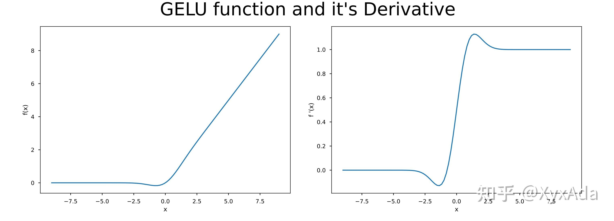
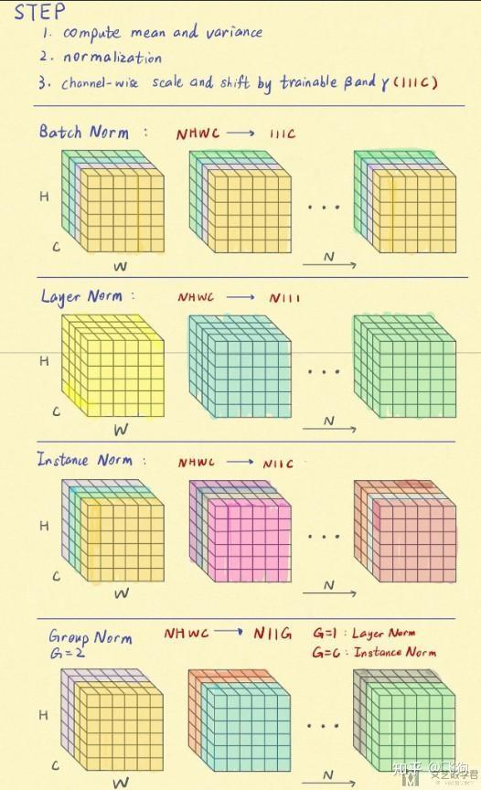
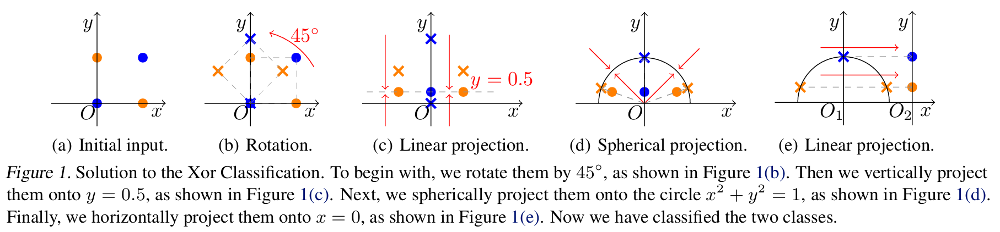
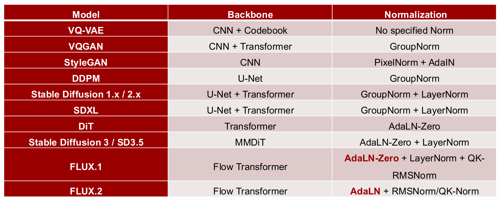
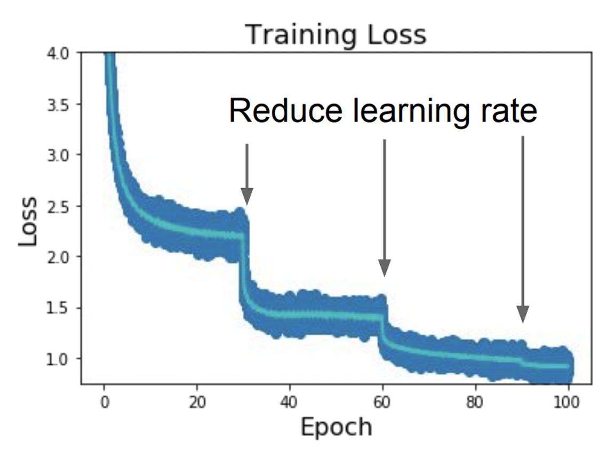
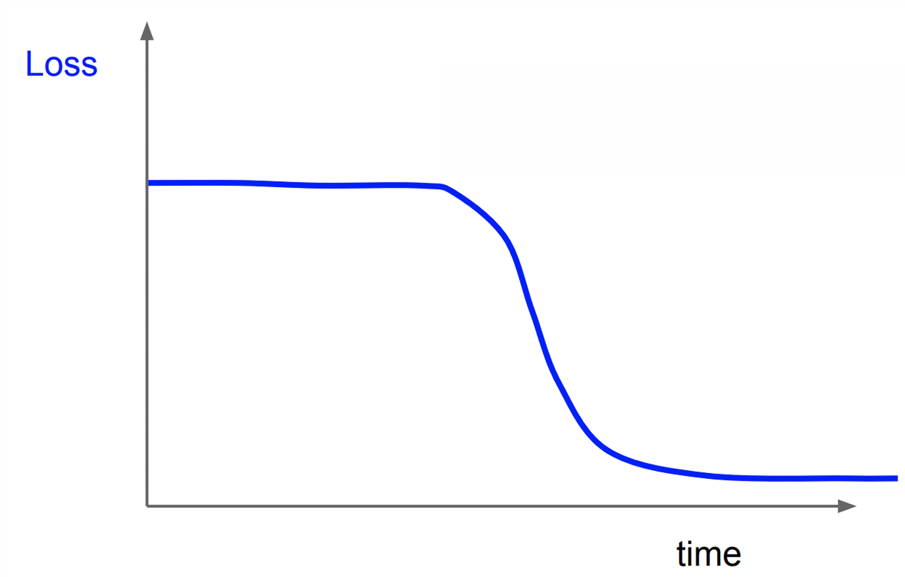
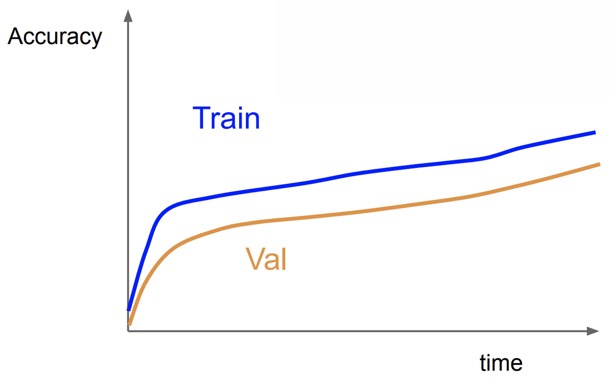
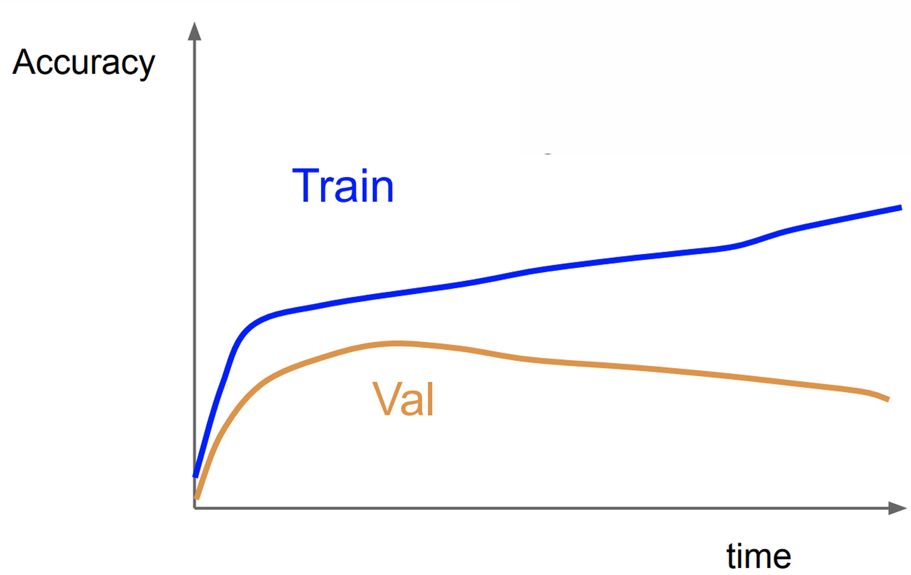
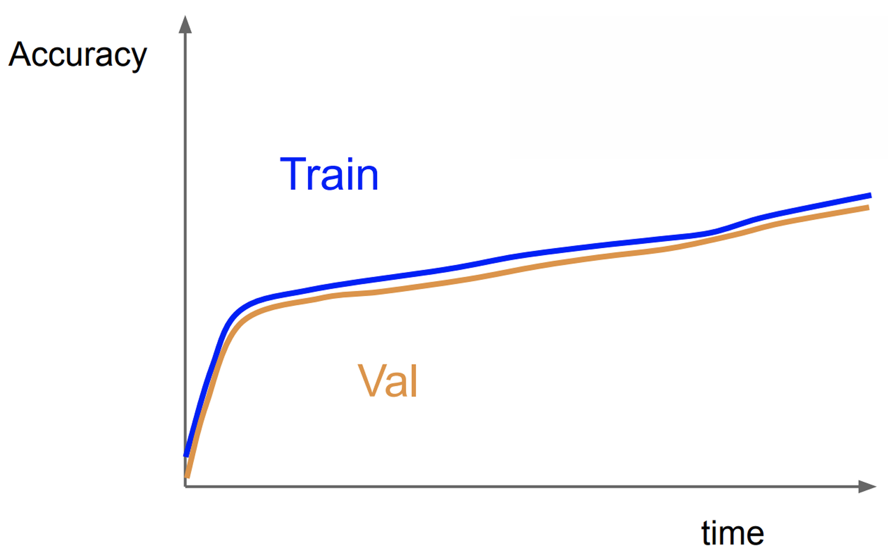

这部分不会系统地讲任何机器学习的知识，甚至都不是传统的深度学习会着重讲的内容。具体会讲两个内容：

1. 近期常用的非线性激活函数
2. 近期常用的归一化层

光听这两个主题就感觉这个 introduction 非常神秘啊……

# 一、非线性激活函数

第一个问题是：为什么非线性激活函数是必要的？如果没有非线性激活函数，只有全连接层，那么不管有多少层，经过整合后仍然是一个全连接层。这就是为什么会出现非线性的变化，它能让模型的表达力显著变强。

这个变强可不止一点，加入了非线性激活函数后，神经网络可以拟合任意连续函数。怎么证明这个理论呢？

从最简化的情况开始：输入一个 $x$；只有一个隐层，隐层只有一个神经元，是 $Wx+b$ 的；一个输出层，配备有激活函数。此时通过变大这个神经元的 $W$，可以使 Sigmoid 的弯曲程度变大；当它特别大的时候就可以近似一个突变函数。因此，我们通过一个神经元就实现了突变函数。那么毫无疑问，如果有两个神经元，就能完成两次突变；神经元越多，完成的突变就越多。而根据黎曼积分，任何一个连续函数都可以微分成一些线性函数和一些突变函数的组合，因此神经网络可以拟合任意连续函数。

早在 1989 年，Universal Approximation Theorem 就提出了这个定理，也就是“当隐层宽度趋于无穷时，单个隐层就可以模拟任何连续函数”。后续又有拓展，比如“当输入维度为 $d$ 时，$d+1$ 个神经元的隐层可以近似表示任意连续函数”，以及“隐层宽度为 1，但无限深度的 ResNet 可以拟合任意连续函数”，证明就不细说了。

有些什么非线性激活函数呢，早期的就不细讲了，包括 Sigmoid, Tanh, ReLU, Leaky ReLU 等等。这些激活函数虽然简单，但其实有很多问题：

- Sigmoid 的输出恒为正，导致它的前一层全连接层中，权重的所有参数会同向变化。相关证明可以自行搜索。
- ReLU 有相同的问题。
- Leaky ReLU 在 $x=0$ 处梯度不确定。

好了现在进入重点，那我们现在主流的激活函数都有些啥呢？

第一个是 **GELU**（Guassian Error Linear Units），它被用于 BERT, ROBERTa, ALBERT, GPT-1/GPT-2/GPT-3 等等网络中。它是一个很像 Leaky ReLU 的激活函数，公式长下面这样：

$$
f(x)=x\Phi(x)=0.5x(1+\tanh[\sqrt{2/\pi}(x+0.044715x^3)])
$$

前者很简洁但很抽象，后者很复杂但很具体。这个 $\Phi(x)$ 就是标准正态分布的分布函数值，后面这一串是把它展开然后**取近似**之后的结果。下图展示了它的函数形状以及导数形状，可以看到长得和 Leaky ReLU 真的很像，并且解决了原点处的梯度问题。

    

下一位是 **Swish**，它也超级简洁，就是 $f(x)=x\sigma(x)$，其中 $\sigma$ 就是 Sigmoid。它的形状和 GELU 很类似，我就不给图片了。值得一提的是，GELU 也可以写成类似的形式，即可以近似成 $x\sigma(1.702x)$。因此有时也把 `Swish(x)` 当做一个大类 $x\sigma(\beta x)$，这样 GELU 也是 Swish 的一种了。

接着是 **SwiGLU**，它是 Swish 和 GLU（Gated linear units）的杂交版。所谓 GLU 就是把一个向量做两个不同的线性变换，对一段做 Sigmoid 后与另一段做点积。它的核心思路是引入了**门控机制**，做 Sigmoid 的这一段实际上是产生了一个门控信号，能够量化每个特征的重要性。而 SwiGLU 仿照 GLU 的做法，先对输入 $x$ 做两个不同的线性变换，然后对一段做 Swish 另一段不做，最后点积。写成公式就是：$\operatorname{SwiGLU}(x)=\operatorname{Swish}(xW+b)\odot(xV+c)$。这里的 $W,V$ 是可以学习的参数，也是除了 Leaky ReLU 以外唯一可以学习的非线性变化函数。

# 二、归一化层

过拟合大家都知道，就是模型过度训练了，学了一堆训练集中的细节，把分刷得巨高，结果到测试集发现自己是傻逼。那怎么解决这个问题呢？

这个问题回答不出来的话……你可以赶紧记住下面这一段内容。首先从问题本质的角度，还是你训练集不够好，要是你训练集里面啥都有了，那你模型学啥都是好东西。所以一个很自然的想法是进行**数据上的修复**，包括：

- 大规模的高质量数据
- 数据增强
- 合成新数据

那如果从模型的角度，我们就需要**修改模型结构**，包括：

- DropOut/DropPath，随机失活一些神经元，限制模型不能依赖所有神经元进行判断
- Weight Decay（权重衰减），比如 L1/L2 正则化
- **归一化层**

注意主角已经出来了。但是我们还没说完，我们还可以从**训练方式**上防止过拟合，包括：

- Multi-task Learning（多任务学习），意思是同时设置多个 Loss，要求同时下降。这样模型更容易学到足够有泛化性的特征。
- Gradient Clipping（梯度裁剪），把梯度限制在某个区域内。防止梯度爆炸，基本上但凡大一点的网络都会用。

上面这些内容建议全文背诵，以后用得上哦。既然我们说过拟合是因为数据不够，而多模态领域就是一个数据严重不够的领域，你别说只有图或者只有文字了，我们还得有匹配的图文，这难度就高多了。因此，针对多模态模型，一个常用的做法是，首先训练只处理单模态的模型，等训练好以后，只训练一个桥接多个模态的桥接模型。

好了我们回归主题，下面我们会讲，**为什么归一化层能够防止过拟合**。不知道你先看我哪个笔记，但在我先写的生成模型基础笔记中，已经介绍过四种归一化方法了。也不需要劳烦你跑到那边去，我在这边重新写一遍。

大家都知道，归一化其实就是对一组数据，根据它们的均值与方差进行变换，使得它们的分布趋势保持不变，同时消除尺度的影响。对于一组数据，归一化的公式是：

$$
y = \gamma\cdot \frac{x - \mu}{\sqrt{\sigma^2 + \epsilon}} + \beta
$$

其中 $\epsilon$ 就是一个很小的值，防止方差为 0 用的，一般可以忽略。因此，$(x-\mu)/\sigma$ 就是把这组数据变成均值为 0，标准差为 $\sigma$ 的数据，而 $\gamma,\beta$ 就是把它们变成均值为 $\beta$，标准差为 $\gamma$ 的数据。

大家可能比较熟悉 BatchNorm，也就是批归一化。除了 BatchNorm 和 LayerNorm 以外，还有两种叫 InstanceNorm 实例归一化和 GroupNorm 组归一化。它们的区别只是在于，被用于归一化的数据划分方式不同。先放图片，再讲解。

    
    
这个图画的还真挺好看的

如图，我们输入的是一个四维矩阵，为了便于理解，我们拆开了第四维 $N$，表示一个 batch 中有 $N$ 个样本，每个样本有 $C$ 个通道，每个通道宽为 $W$，高为 $H$。图中相同颜色的方块表示它们要放在一起归一化，具体而言：

- **BatchNorm**
  - 把所有样本中，只要在同一通道内，就放在一组里面
  - 适用于 CNN
  - 但当 batch size 太小时效果不好，不适用于 RNN
- **LayerNorm**
  - 对单个样本的所有数据放在一组里
  - 适用于序列模型，如 RNN，Transformer
  - 不适用于输入变化很大的数据，且当 batch size 太大时效果不好
- **InstanceNorm**
  - 对单个样本，在同一通道内的所有数据放在一组内
  - 适用于图像风格迁移
  - 不适合对通道之间有较强相关性的数据使用
- **GroupNorm**
  - 是对 InstanceNorm 的变体，对单个样本，对通道进行分组，每一组中的所有数据放在一组内。当组数 $G=1$ 时，就是 LayerNorm；$G=C$ 时，就是 InstanceNorm。
  - 在不同的 batch size 下都有较好的稳定性
  - 但在大的 batch size 下效果略差于 BatchNorm

我们从 BatchNorm 开始，它能够使模型获得更好的梯度，有更高的学习率。所以为啥呢？因为以前我们使用 Sigmoid 的时候，先将 $x$ 通过 Sigmoid，再进行后续操作，因此梯度是

$$
\frac{\partial L}{\partial x}=\frac{\partial \sigma(x)}{\partial x}\cdot\frac{\partial L}{\partial \sigma(x)}
$$

而大家知道，$\sigma(x)$ 在 $x$ 较大或较小的时候，梯度都趋近于 0，因此为了防止梯度消失，大家就把数据都压缩到靠近 0 的位置，不大也不小。因此这个时候，大家都把 **BN 层放在激活函数之前**，为了防止梯度消失。到了后面，大家不用 Sigmoid 了，大家就发现 BN 层也可以放在激活函数后面了，因为首先大家不用担心梯度消失了，其次通过 BN 层的输出天生是**下一层良好的输入**，因为假如是线性层，那么线性层中权重 $w$ 的梯度就更可控了，训练起来也更稳定。因此，现在主流的思路是把 **BN 层放在激活函数之后**。

那再讲一下 BN 层到底是对哪个维度进行计算，上图给出的是对卷积层输出 $[N,C,H,W]$ 的计算方式，也就是对一个 batch 中在同一通道内的所有位置操作，我们可以记作 $[N,C,H,W]\rightarrow[1,C,1,1]$，所有记为 1 的维度说明它们被归一化了。而对于全连接层的输出 $[N,D]$，就是对每个样本的同一位置进行操作，变为 $[1,D]$。

那 BN 层有啥问题呢？它的操作是，对所有数据取均值除以方差，也就是说，这个操作与你输入的数据相关。问题来了，训练集和测试集中，这个数据可不一定一样，甚至大概率不一样。这就导致训练出的模型和测试时的模型**不一样**，这其实是很致命的，就像你平时吃饭的时候正常用筷子，到尿急的时候拿筷子的方式就变了（？），导致你没法好好吃饭，这非常严重。有人想了一个办法，就是在训练集中持续记录所有均值和方差，等到测试的时候就固定住，不过这仍然难以彻底解决这个问题。

因此 LayerNorm 应运而生，它对一个样本内部的所有位置进行归一化。它就缓解了上述问题，因为每个样本都不会再受到旁边样本的影响了，影响就大大减小。对线性层，$[N,D]\rightarrow[N,1]$；对卷积层，$[N,C,H,W]\rightarrow[N,1,1,1]$。

后来 InstanceNorm 又被发明出来，它对一个样本中一个通道的所有位置进行归一化。它主要被用在**风格迁移**上，为什么呢，首先肯定不能做批归一化了，这会导致别的样本会影响当前样本的风格迁移；其次实验发现，风格迁移时别的通道也最好不要影响当前通道的变换，因此又把通道给隔离了。时至今日，对图像风格迁移的模型来说，InstanceNorm 仍然是常用的归一化层。对卷积层，$[N,C,H,W]\rightarrow[N,C,1,1]$。

GroupNorm 就没啥好说的了，其实只是统一了 LayerNorm 和 InstanceNorm 而已。现在大家想想，为啥 BatchNorm 不适用于 batchsize 比较小的情况呢？其实挺显然的，你 batchsize 太小，那被归一化的数据量就很小了，几乎是对一些随机数据做归一化，用处就不大了。这时就用 LayerNorm 比较好。而 GroupNorm 是在做显存需求较大任务时的一种折中方案，现在在一些检测、分割的任务上，仍然是主流方案。

在这四种的更后面，就有了更多的变体，比如 **RMSNorm** 就是 Layer Norm 的变体，它和 LayerNorm 操作的元素是一样的，但是去掉了算均值和方差中“减去均值”的操作，因此公式如下：

$$
y=\frac{x}{\sqrt{\frac{1}{d}\sum_i x_i^2+\epsilon}}\gamma
$$

有人就要问了为什么可以删掉这个减去均值的操作，我的评价是我也不知道，反正实验证明它的效果和 LayerNorm 差不多，计算量还比 LayerNorm 小，因此也挺好用的，现在被 LLaMA 等大模型使用。

最后一个问题是，这些归一化层到底是线性变化还是非线性变化呢？

    

显然是非线性变化，而且它是解决异或分类问题的一种方法。请看上图，我们用一些神秘变换解决了异或分类问题。首先旋转 45 度，它仍然是线性变换，而此时还是没法分类。其次，线性投影到 $y=0.5$ 处。接下来 (d) 就是最关键的一步：进行球面投影，这一步就是 RMSNorm。做完这一步以后，再来一次线性投影，就实现了分类。这一段是一个简化的不严谨的证明，实际上这篇原论文 [On the Nonlinearity of Layer Normalization](https://arxiv.org/abs/2406.01255), ICML 2024 进行了非常精彩的数学推导，感兴趣的朋友可以看看。

大家可能好奇现在一些开源多模态大模型都在用什么归一化层，这个得分两个模态来看。在语言方面，大家基本统一使用 RMSNorm 了，又好用又快。而在视觉上，除了早期 CNN 盛行时大家喜欢玩 BatchNorm，后来基本统一为 LayerNorm 了，不过也偶尔有模型使用 RMSNorm 出奇效，比如 Qwen2.5-VL。而 GroupNorm 和 InstanceNorm 等等就基本被用在单模态任务上了。

而生成模型这边呢，就比较混沌了，我决定先把表挂出来给大家看：

    

在最初的 VAE 阶段，大家甚至没有使用归一化层的意识。而等到 GAN 时期，由于 GAN 的训练**高度不稳定**，因此很有可能你只是加了个 BatchNorm，就导致整个模型完全 train 不出来。因此它催生出了大批归一化方式，百花齐放。直到进入 Diffusion + Transformer 时期，大家才稳定使用 GroupNorm + LayerNorm。为什么会使用 GroupNorm 呢，因为 U-Net 是一个输入输出维度巨高，而中间隐藏层维度比较低的网络，这就导致它超级吃显存，为了省显存，大家就采用 GroupNorm 这种这种方法了。现在的主流方法，就是 LayerNorm 或者 RMSNorm 了，同时加上了某一个神秘归一化机制：AdaLN 和 AdaLN-Zero。

什么是 AdaLN 呢，它的全名叫 Adaptive Layer Normalization，后面两个单词和 LayerNorm 一模一样，也就是加了个 Adaptive 而已。事实上它俩的计算方式也超级相似，我把两个的计算方式列出来，大家来玩找不同。首先定义

$$
LN(x)=\frac{x-\mu}{\sqrt{\sigma^2+\epsilon}}
$$

LayerNorm 的计算方式是

$$
y=\gamma\odot LN(x)+\beta
$$

而 AdaLN 的计算方式是

$$
[\gamma, \beta]=MLP(c)\\
y=\gamma(c)\odot LN(x)+\beta(c)
$$

诶这个 $\gamma,\beta$ 都变成了关于 $c$ 的函数，$c$ 是什么呢？它是 Condition 的缩写，包括 diffusion 的时间步 $t$、类别标签、prompt 的词向量等等，都是这俩参数的先验。也就是说，生图模型为了重视这些输入，把它们融入到了归一化层中，要求这些参数也自适应输入。

那什么是 AdaLN-Zero 呢，先看计算方式：

$$
\gamma_1, \beta_1, \alpha_1, \gamma_2, \beta_2, \alpha_2=MLP(c)\\
x=x+\alpha_1(c)\cdot\text{Attention}(\gamma_1(c) LN(x)+\beta_1(c))\\
x=x+\alpha_2(c)\cdot\text{MLP}(\gamma_2(c) LN(x)+\beta_2(c))
$$

怎么复杂了这么多😓其实核心的操作就是这个 $x=x+\cdots$，它参考了 ResNet 的思路，当这些参数全初始化为 0 时，至少能保证输出不变，它能使整个模型训练过程比较稳定。

# 三、怎么训一个模型？

这部分不是考试范围内的了，但还挺有意思。假如你是一个新手，还没训过模型，需要怎么优雅地打造你的第一个炼丹炉？

第一步，先检查一下模型的**初始损失值**正不正常。所有参数全部随机初始化，然后直接跑一次，损失值应该大概在一定范围内，比如对于 $C$ 分类任务，就差不多是 $\log(C)$ 左右。

第二步，把模型过拟合到一个超级小训练集。按理来说，一个合格的模型至少能死记硬背住几个小 batch 的数据，因此这一步应该是能做到的。如果不能做到，就得考虑下模型是不是有问题了。

第三步就是调学习率，这个大家比较熟悉，学习率不能太大也不能太小。通过这一步以后，大家就可以慢慢扩大训练规模，加大 epoch 数，然后观察损失值和准确率曲线了。

那问题来了，我碰到了下面这些曲线，我应该怎么做？

    

这个答案在图里面了，如果你的损失值在某个 epoch 卡住了下不去，那大概率是模型接近损失低点了，但 lr 太大步子太宽，需要在这里降低学习率。这里使用的是分段学习率的手法，比如 ResNet 就在第 30, 60, 90 个 epoch 的时候把学习率除以 10。不过反过来，如果说你提前在第 30 个 epoch 设置学习率下降，结果反而在学习率下降以后损失值不降了，说明大概率你不该降。（这 tm 不废话吗）

    

这个的问题是损失值得好久才开始下降，说明参数初始化出问题了，需要考虑换个初始化的方法。

如果损失值已经稳定下降了，这时你会考虑看看准确率如何。

    

这种情况是非常好的！说明你的模型正在稳中向好，只需多训练一会即可。

    

恭喜你过拟合了！请回顾前面我们说的解决过拟合的方法。

    

看起来很好，但是你的模型在训练集上的效果怎么和测试集差不多啊……首先你需要检查训练集和测试集有没有可能搞混了（笑）其次这很可能是一个欠拟合的模型，因为训练集刷的不好。可以考虑提升模型的复杂性，以及多训练一会。理论上训练集是能够刷好的！

总而言之，我们希望训练集稳定比测试集的准确率高一点，但不能高太多，大家可以基于此参考。