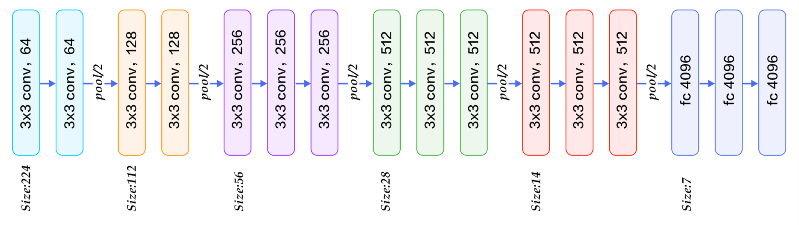
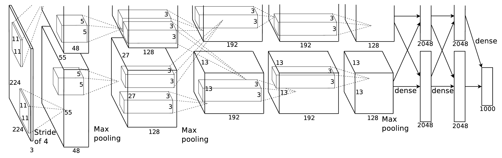
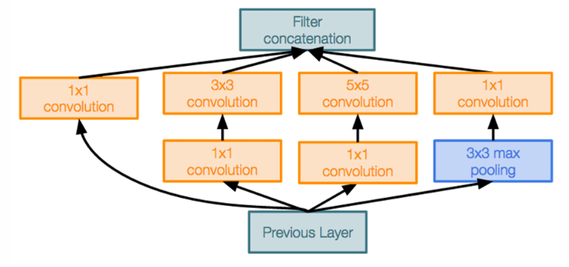
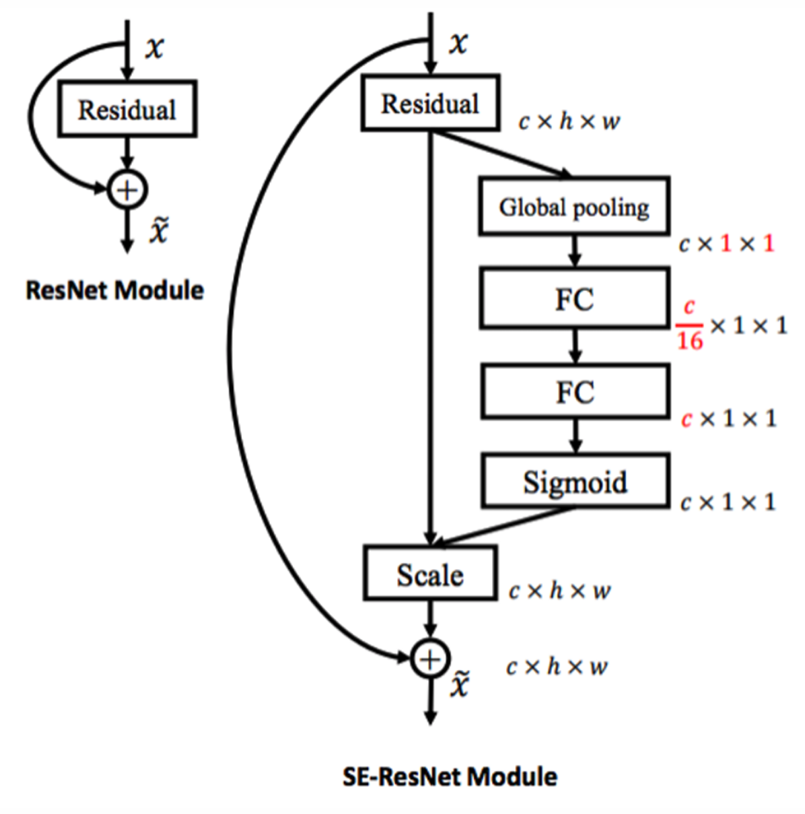
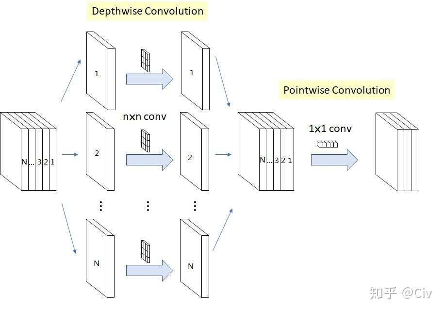
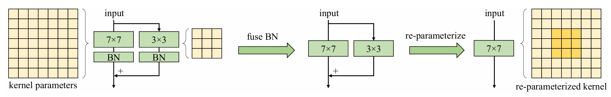
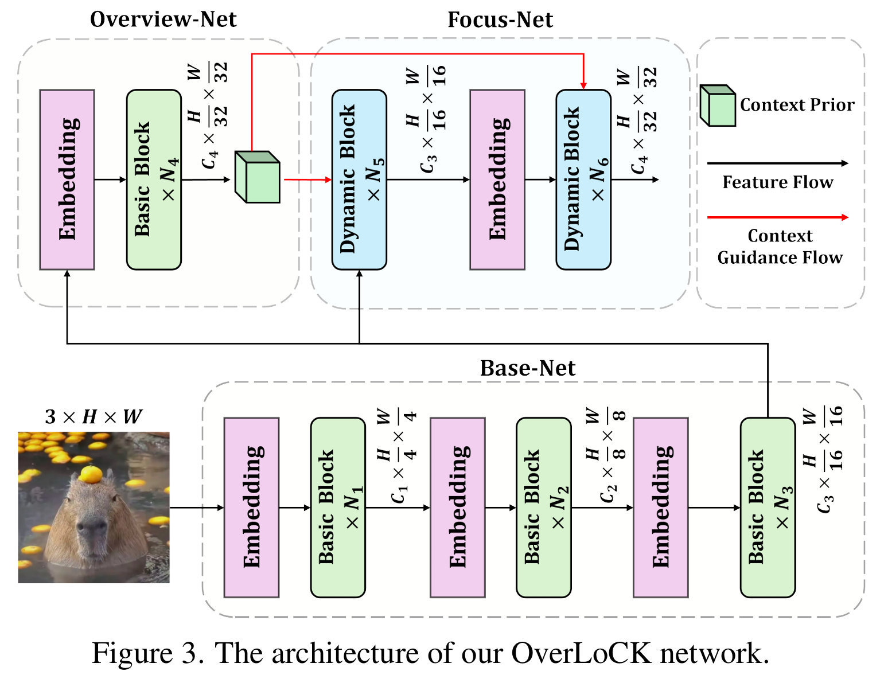
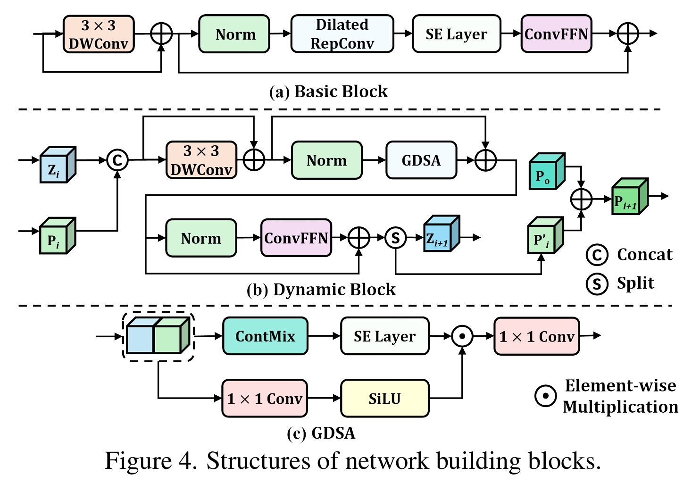
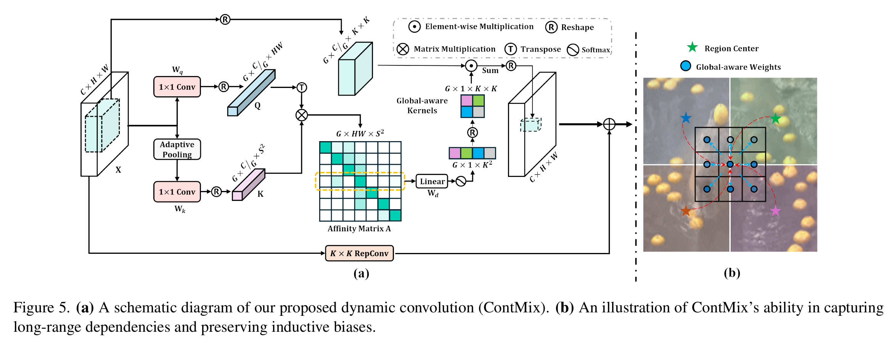

在有了一点点机器学习基础以后，我们来到计算机视觉的基础，大家知道 CNN 就是在这里出生的，不过现在似的差不多了。所谓计算机视觉，就是希望模型能够理解图片和视频等数据，它的起源大概是 David Marr 的《Vision》，它基本上是公认的视觉领域的开山之作了。我们仍然不会详细介绍 CNN，具体来说会讲这两个东西：

1. CNN 模型的一些变体
2. 在 Transformer 吊打 CNN 以后，还有哪些人在坚持 CNN

# 一、为什么是卷积？

老生常谈的话题，在处理一张 $200\times200$ 的图像时，假如用一个全连接层，那参数量就爆炸了，一个隐单元就得用四万参数，更别说一个隐层得有好多隐单元了。因此，为了减小参数，大家就想到了，其实图像上隔得很远的像素，不需要一块考虑。同时，对于图像上的不同像素，也不见得需要用不同参数去处理。因此卷积操作就出现了。

卷积计算方式略去。

发明了卷积核这种操作以后，台下观众欣喜若狂，发现只需要有个卷积核，就能实现**模糊、提取边缘**等操作。同时，参数量直接锐减，我们甚至可以同时学习多个卷积核。

计算卷积层参数量的方式，以及计算卷积层输出形状的方式略去。

这时就有了一个很神秘的操作：$1\times1$ 卷积。这个操作还挺常用的，但这看起来一点都没道理，完全不看其他像素，它能有什么功能呢？它的真正作用是**控制输出通道数**。因为卷积输出的通道数是卷积核数，因此它可以在不破坏空间关系的同时，调整通道数。

简单总结一下吧，对于一个 $C\times H\times W$ 的输入，卷积层有下面四个超参数可以调整：

- 卷积核数量 $K$，一般可以调 $\{32, 64, 128, 256, 512\}$；
- 卷积核宽高 $F$，一般可以调 $\{1,3,5,\cdots\}$；
- Stride 步长 $S$，一般可以调 $\{1,2\}$；
- Padding 补零 $P$，一般可以调 $\{0,1,2\}$。

而最后的输出形状为 $C'\times H'\times W'$，分别是

- $C'=K$
- $H'=(H+2P-F)/S+1$
- $W'=(W+2P-F)/S+1$

参数的数量就是卷积核大小 $F^2C$ 乘以卷积核数量 $K$ 加上偏置数 $K$。这些其实大家举个例子倒一倒就好了。可以看到卷积核对输出的形状非常可控，完全可以通过调整卷积核的超参数精准控制输出形状。

# 二、卷积神经网络

## 1. 计算网络性能

卷积就是卷积神经网络的核心了，剩下的都是一些细节罢了。比如 **VGG-16**，它就是一通卷积爆算，最后需要进行分类，那我就先把 $[C,H,W]$ 的矩阵摊平，接几个**全连接层**，把维度降到类别数就完事了。

    

那为啥 VGG-16 中间还有一些**池化层**呢，因为最后的全连接层参数量还是大了点，池化层就进一步丢掉一些像素。为啥池化层是合理的丢弃，因为在大部分任务上，人眼对于像素的偏移没有那么敏感，相当于自带个过滤器。而池化层就是这个过滤器，它不会让某个像素发生轻微偏移时影响整个结果。池化层可爽了，它本身一个参数没有，而可以对矩阵进行降采样，大大降低后续的参数量。池化层也有几类，比如取最大值、均值等等。有人问了，要是池化层的边长没法整除图像边长咋办？实际上会自动向上取整。

有了这些层就无敌了，大家就疯狂搭建模型，但是怎么比较呢，伟大的 ImageNet 就出现了，这就是计算机视觉当年的白月光，大家都拿着这个数据集训练和测试。这时候也有一些模型脱颖而出，比如 **AlexNet**，不过说白了就是各种层玩拼图罢了。这里就不展开了，希望大家能拿到一个卷积神经网络时，可以计算出每个层的输入输出形状、超参数、内存开销、参数量、浮点运算数等等。

    

……等会，什么叫内存开销和浮点运算数？计算方法是这样的，**内存开销（memory）** 实际上是输出占大头，也就是 $C'\times H'\times W'$。然后，每个 32 位浮点数是 4B，而 1KB=1024B，因此内存开销就是 `输出内存 × 4 / 1024`。参数量再强调一下：

- 不要忘记卷积核也是有深度的！！！
- 不要忘记加偏置！！！

而浮点运算数（flops，单位 M 百万数）怎么算呢？这样想，每个输出的位置，其实是**单个**卷积核中的每个元素做了一次乘法，再全部加起来得到的，对吧？（为什么是单个卷积核，因为一个卷积核只管一个输出，大家想想是不是这样）那么对于输出的每个位置，运算数就是卷积核大小 $CF^2$。再乘以输出大小 $KH'W'$，得到浮点运算数，再化单位即可。

池化层怎么计算输出尺寸、内存开销、参数量、浮点运算数呢？

- 尺寸记得除不尽的时候向上取整。
- 内存开销仍然取决于输出形状。
- 参数量显然为 0。
- 浮点运算数的思路是一样的，每个输出位置的计算数是池化大小 $K^2$（不管你是比大小还是取平均，都得遍历整个池化窗口），再乘以输出量即可。

其次是 Flatten 层：

- 尺寸就是完全展平为一维向量。
- 内存开销仍然取决于输出形状。
- 参数量显然为 0。
- 浮点运算数显然也为 0，压根不用运算。

最后是全连接层：

- 尺寸很显然，内存开销也很显然。
- 参数量记得加偏置，也就是 $C_{in}\times C_{out}+C_{out}$。
- 浮点运算数就是 $C_{in}\times C_{out}$。

这里我估计是必考的，因此虽然我感觉我会了，仍然认真地跟着过了一遍，读者也可以注意一下。

如果真的把 AlexNet 的各层的内存开销、参数量和 MFLOPS 统计出来，会发现：

- 内存开销很靠前，因为前面的输出很大，后面过池化以后就越来越小了。
- 参数量基本都堆在全连接层。
- MFLOPS 也很靠前，也是因为前面的输出很大。

## 2. GoogleNet

这些问题也很好解决，**GoogleNet** 做了下面这些改进：首先在开局疯狂池化，先把内存开销打下去再说。其次在全连接层前面加了一个 Global Average Pooling，我不展平了，我直接把一个通道内整个做一个平均池化，把全连接层的参数量也打下去。这两个操作会不会太激进了呢，其实影响也不大，主要是图像分类任务太简单了，这些空间上的信息都可以不管，随便做。碰到图像分割这种比较难的任务就老实了。

而第三个操作是从模型上面优化以提升能力，首先就是把网络做深了，这也是我不放它模型架构图的原因，太长了根本放不下，在原论文里都占了一页，[不信自己看](https://arxiv.org/pdf/1409.4842#page=7)。越深的模型效果就越好，这是大力出奇迹的体现。

其次是对卷积层的优化，原版的卷积层看着优雅，实际上只能使用一个尺度的卷积核，要么 3×3 要么 5×5，效果并不好。因此这里依旧力大砖飞，一个尺度不够就多弄几个呗。

    

但是大家会注意到，为啥一定要在每条路都放一个 1×1 的卷积核呢？因为这个结构中最特殊的区域：池化层，它是没法降低通道数的，也就是说最右边这条路的通道数一定等于原始输入。因此，假如你不通过这些 1×1 的卷积核，去降低另外三条路的通道数，那最后进行拼接以后，通道数就会暴增。所以简而言之，还是为了缩小通道数去做的操作。那为什么 1×1 的卷积核，要放在 3×3 和 5×5 的卷积核之前，且是池化层之后呢？全都是为了降低参数量。运行效率倒是不必担心，四条路可以并行。

## 3. ResNet

由于 ImageNet 的影响，2014 年的计算机视觉模型卷的很厉害，大家都疯狂堆深度，在竞赛上取得越好的成绩，模型就越被大家看重。但是很奇怪的是，第一名 GoogleNet 堆了 22 层，第二名 VGG-19 堆了 19 层，为啥都不是个整十漂亮数呢？答案是真的堆不了了，再加层数反而效果会下降。这也太反直觉了，不过大家都知道，2015 年，将出现一个横扫各大榜单，且能把深度堆到高达 152 层的神秘模型：**ResNet**。

Residual Network 专注的就一件事，为啥层数堆不上去。最初的想法是，莫非是过拟合了？但是并非，当层数太多时，训练集上的损失就已经很高了，因此是一种欠拟合问题。那回归模型本身，既然我层数多了还不如层数少的，那说明后面加的层都在吃白饭啊，你们也别干活了，就把前面的输出往下传就行了。也就是这样粗暴的思路，促成了 ResNet 的实现。

原始的一个基础结构，大概是 `3×3 conv + relu + 3×3 conv + relu`，这里是两层卷积。残差连接的操作，就是在两个卷积之后，接收最初的输入，也就是 `3×3 conv + relu + 3×3 conv` 后加上输入，这样一个结构也叫 Residual Block 残差块。现在大家也都知道，它还顺便解决了梯度消失和梯度爆炸的问题，堪称四两拨千斤的典范操作了。

## 4. SENet

ImageNet 的最后一届比赛发生在 2017 年，这一年的冠军是 **SENet**（Squeeze and Excitation Network），核心思路继承了 ResNet，只是在残差块之后加了一些操作。可以看到，在残差块输出后，先是过了一个 Global Pooling 得到一个通道整体的信息，然后通过两个 FC 层使模型能够学习到特征，最后经过 Sigmoid 使得输出在 0 到 1 之间，由此得到一个门控信息以后，点乘给原始输出，让它进行权重的放缩。因此整体的思路就是希望输出能够自适应地按通道进行权重缩放。

    

那为什么用两个 FC 呢，原因有二，一方面是参数量下去了，另一方面是整个流程更加可以人工调控。如果只有一个 FC，它的形状固定为 $c\times c$，不太方便调整。

## 5. Small DNN 与 DSC

2017 年为啥就成最后一届了呢，因为 SENet 把误差刷到低至 2%，结果有人人工做了 ImageNet 的分类任务，居然也有 5% 的误差，这就导致人们开始反思：接着刷分真的有意义吗？因此渐渐有些人开始把目光着眼于**如何把模型做小**，也就是实现 Small Deep Neural Network（2014-2019）。Small DNN 的好处不少，训练快、更容易部署、远程更新快。大家能想到哪些把模型做小的方式呢？

- 别用全连接层
- 降低通道数
- 卷积核宽高调小

除了这三个模型架构的调整，也是我们上文已经介绍过的一些方法以外，还有下面这三种方法：

- Distillation & Compression：前者是大名鼎鼎的蒸馏。有一个大模型和一个小模型，我们让小模型去学习大模型的输出。而后者是剪枝，如果权重值较小，说明它没啥用，可以删掉。但是删掉肯定会影响模型性能，因此还需要删掉后重新训练。
- Quantization：把 32-bit 的参数削到 8-bit 或者 4-bit。
- Depth-wise Separable Convolutions：下面重点介绍。

除了架构、压缩以外，还有一个就是在实际应用时做优化，这里就不展开了，大家可以自行搜索：

- Early Exit
- Token Pruning
- MoE（之后会讲）
- Dynamic Routing

在这条路上经过了 SqueezeNet-MobileNet-ShuffleNet-EfficientNet-GhostNet 的发展。这里有一个重要的创新是 Depth-wise Separable Convolutions，它最早在一篇博士学士论文 *Rigid-motion scattering for image classification* 中被提出，后来用于 Xception 和 MobileNet 中。

    

传统的卷积层，需要 $N$ 个卷积核，每个卷积核大小是 $[M, D, D]$，其中 $M$ 是输入通道数。而它把卷积操作拆成两步，第一步不是对所有通道一块卷了，而是每一层配备一个卷积核，每个卷积核只卷一层，因此需要 $M$ 个小卷积核，每个大小为 $[1,D,D]$。第二步才是用 1×1 的卷积核把通道合并，因此需要 $N$ 个卷积核，大小为 $[M,1,1]$。显然，参数大小和计算量都下去了，这里带大家计算下计算量。标准卷积的计算量是 `单个卷积核大小×输出大小`，即 `D×D×M×N×H'×W'`，而新卷积的计算量是 `D×D×1×M×H'×W'+1×1×M×N×H'×W'`，做商得到比值为 $1/N+1/D^2$，也就是说当 $D=3$ 时，大约就是原计算量的九分之一。

仅仅把传统的卷积换成 DSC 卷积， MobileNet 就能做到在计算量和参数量小于 GoogleNet 的情况下达到相当的性能。

而另外四篇文章的核心创新点分别是：

- SqueezeNet（2016）是第一个宣称要以降参数量为核心的网络，它提出了 Fire Module，其实就是多用 1×1 的卷积核（Squeeze），以及并行 1×1 和 3×3 的卷积计算以提取特征（Expand）。这两个操作主要优化的是模型大小，但并没有减少计算量，因为输出的尺寸仍然很大。
- ShuffleNet（2018）基于 MobileNet（2017），主要优化的是 DSC 的第二步，因为 $M$ 通常比较大，开销仍然很高。因此首先对通道进行**分组**，比如把 64 通道分成 8 组 8 通道，此时只用 1×1×8 的卷积核了。但是这样不就把通道分离了吗，肯定会影响整体理解的。因此核心在于 **Shuffle 打乱机制**，每次都随机打乱通道的顺序，这样就基本上可以在不同位置看到所有别的通道了。
- EfficientNet（2019）和 GhostNet（2020）权衡了参数量和模型性能，这里有很多小细节上的优化，大家可以看原论文。

# 三、CNN 的秽土转生

CNN 在 20 年的时候已经是路边一条了，而在大家玩了很久的 Transformer 之后，还是有人想重振 CNN 荣光，想用 CNN 打败 Transformer 的。

## 1. RepLKNet

第一篇工作是 RepLKNet（CVPR 2022），它的标题就很粗暴，“把卷积核大小开到 31×31”。这个原始的想法是，CNN 效果差，可能是因为卷积看到的区域太小了，把它搞大一点可能效果不错。但是它能 work 绝非易事，会碰到下面这些问题：

**参数量和计算量都会变大**。但作者发现，**超大 depth-wise 卷积**并不会增加多少 FLOPs。同时作者做了一定分析，发现计算机的计算密度是同时受限于计算理论峰值 TP 和内存带宽 B 的。当计算密度很低的时候，那也就不吃计算速度，限制主要来源于内存带宽。因此作者在 **cuda 层面**做了很多内存上的优化，能够实现在更大的卷积核上，虽然计算量确实变大了，但是计算速度却不慢。

**难以关注小尺度特征**。作者只是把 3×3 的卷积核变成了 13×13 的，模型能力直接暴跌 15 个点，说明大卷积核难以关注小尺度特征。因此作者想到了残差块，在 13×13 的前面加一个 3×3 的卷积核，同时加上残差连接，因此鼓励模型同时保留 3×3 卷积的输出。这种 **shortcut** 操作是准确率提升最关键的设计。

**参数量太多导致优化不好**。如果模型前面有一个很大的卷积核，它离损失函数很远，这部分参数很难训练。因此作者参考了 RepVGG（2021）的结构（其实 RepVGG 也是他们的工作），就是在训练阶段，在大卷积核旁边并行训练一个小卷积核，相当于一种鲶鱼效应，因为小卷积核比较好训练，它训练好了就促进输出更好，然后带动大卷积核的训练。而更神奇的是，通过线性代数的计算，可以在测试阶段把这个小卷积核整合到大卷积核中，相当于没增加特别多的计算量。这个操作虽然涨点不多，但反正是涨了。然而这个手法其实没啥参考价值，因为一旦旁边的大网络参数量真的很大，你旁接一个小模型就卵用没有了。

    

**在 ImageNet 涨点不明显**。但是在别的任务涨点明显，比如 ADE20K 语义分割等。怎么解释这个差距呢，作者说，小卷积核它能看到全局，是因为接了很多个小卷积核，层层叠加下，后期的输出中每个元素都看到了前面的每个元素。然而，它消耗的层太多了，大卷积核只需要几层就能看到了，因此在语义分割这种只需要关心大尺度的任务上，效果就好一点。

还有一个比较神秘的发现，**大卷积核甚至可以用于小特征图**。比如，将 13×13 的卷积核用于 7×7 的特征图，居然还有个比较稳定的收益。这个的原因是，当大卷积核在小特征图上移动时，每个小特征图上的位置会与不同的大卷积核的元素做卷积，这就隐性带来了类似于位置编码的效果。

上面这些研究大部分是先做出实验，发现诶居然有奇效，然后再想办法解释。因此大家也可以多做实验，说不定就有惊喜呢。

## 2. PeLK

第二位挑战者是 PeLK（CVPR 2024），它首先把卷积核大小推到了 101，非常暴力。其次有一个比较核心的发现，是借鉴了人眼的特性，当眼睛看一张图片的时候，其实大部分注意都放在中心，而周围的就比较模糊。因此，对大卷积核的外围区域，大家就共享一套参数。就这么一个简单的改进，就拿下了 CVPR，也难怪知乎上差评一片。

## 3. OverLoCK

在保留大卷积核的基础上，OverLoCK（CVPR，2025）的作者受到 Attention 的启发，会不会这种根据输入调整输出的网络结构才是致胜的关键？因此作者尝试设计一种卷积网络，能够根据输入调整对应的卷积核。

    

想法依然来源于人眼的观察特性。眼睛看一张图片的时候，其实会先宏观看一下，再仔细观察细节。因此作者把网络拆分成 Base-Net, Overview-Net 和 Focus-Net。基础观察很简单，不断下采样就完事了。Overview 观察是一步更快的下采样。而 Focus 的一个核心设计是 Dynamic Block，下图展示了它的框架细节。

    

Basic Block 就是一个很基础的提取特征的网络，先做 Depth-wise Conv，然后 RepConv 就是前面 RepLKNet 的卷积核，SE Layer 是 SENet 的残差连接操作。而 Dynamic Block 中的绿色块 $P_i$ 是一个全局状态，它来控制模型输出。这里面唯一没见过的东西是 GDSA，它的全称是 Gated Dynamic Spatial Aggregator，细节也在上图，也是作者最原创的部分了。Gated 说明 SiLU 提供了门控信号，因此上面这条路的 ContMix 应该是最核心的操作了。

    

这个操作包括两部分，首先是中间向右走，它的目标是模拟 Attention 中的注意力机制，想求出图像中每个位置与其他位置的关联。通过上下两条路的变换，上方是一个简单的卷积重塑，下方多了一个池化，把输入聚合到了 $S\times S$ 的大小，也就是更集中了。然后对 $Q,K$ 进行分组点积，得到相关性矩阵 $A$。其次是第二部分，得到相关性矩阵后，把它使用全连接层变化了维度，然后又重置成了卷积核的样子。也就是说，拿着相关性卷积核去对原始特征图做卷积，得到最终的输出。

为什么要分组呢，简单来说希望模型能够对每组之间都能独立学一个相关性矩阵出来。整个流程虽然看起来超级复杂，但是说白了就是通过设计一个类似于 Attention 的卷积核，让卷积效果更好了。因此它也集成了 Attention 的全局视野和卷积的局部操作性，两个好处一次拿下。

## 4. 总结

即使 CNN 看似已经被 Transformer 一脚踢死了，但是 CNN 在实际上仍然是广为使用。一方面，CNN 本身是一个比较规则的计算方式，因此在加速计算上的效果比较好；另一方面，CNN 起步比较早，经过了大量的优化。因此在 CNN 和 Transformer 效果差不多的时候，大家也仍然偏好 CNN。