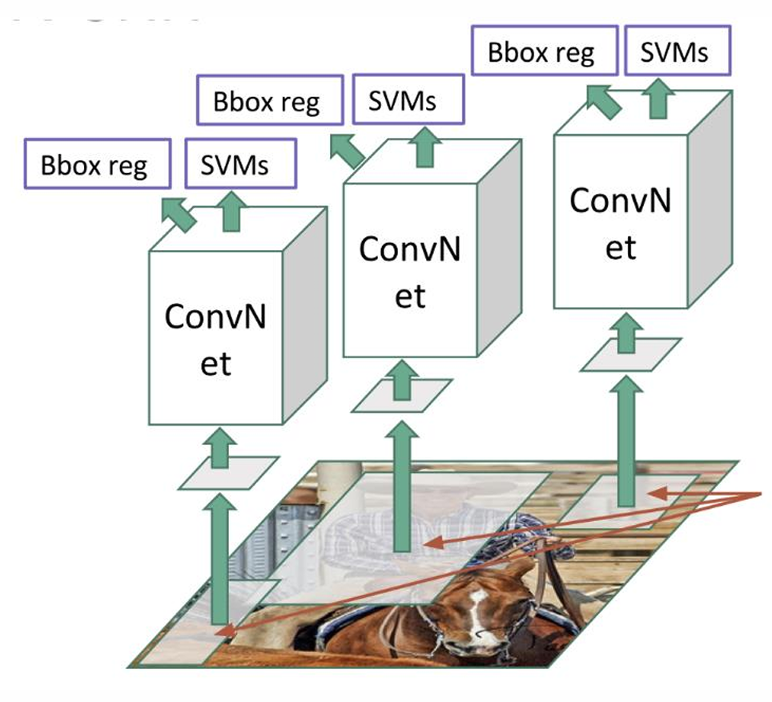
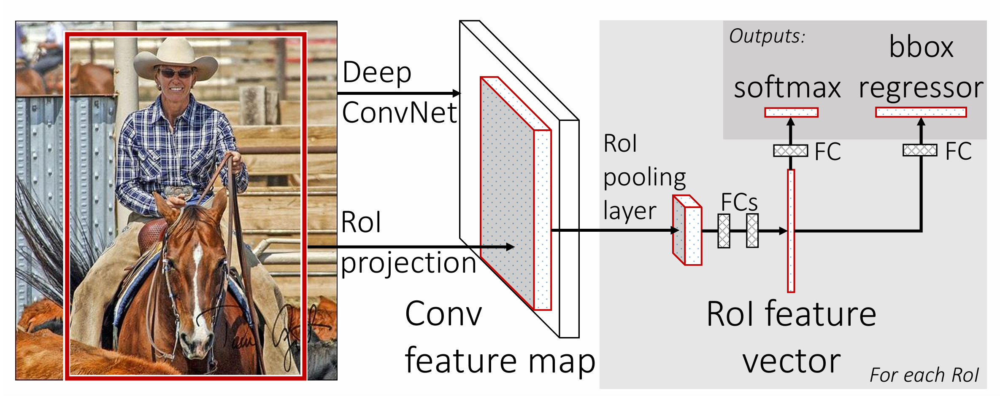
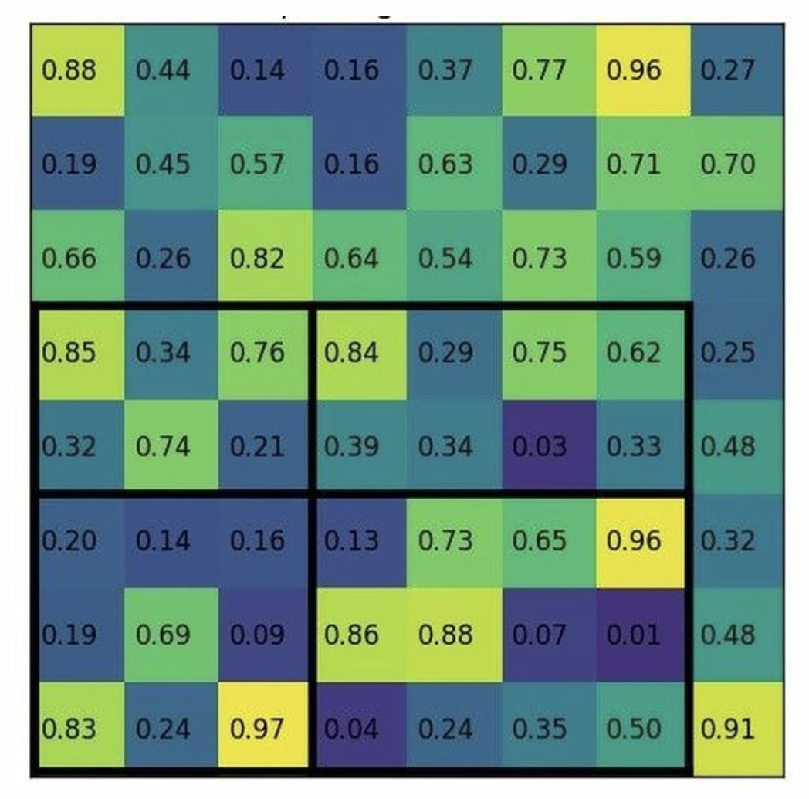
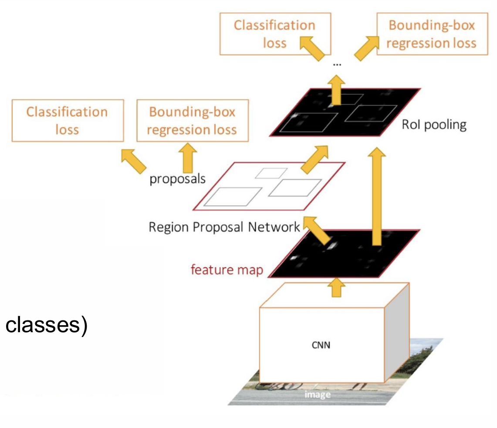
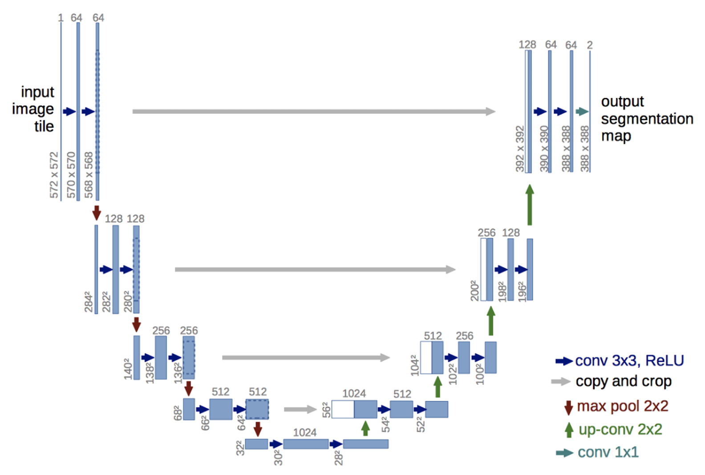

在上一章我们介绍了 CNN 以及它的前世今生，本章我们会介绍 CNN 的高光时刻，兼计算机视觉的两个经典应用——**目标检测和目标分割**。

先给这两个任务下定义，最原始的图像分类任务就是给定图像，要求输出类别。目标检测不仅要找出图像中有些什么东西，还得给出相应的位置信息，具体来说是给出一个外边框，要求刚好能把目标框出来。而分割任务是更细粒度的任务，需要在**像素维度**把目标标记出来。更进一步的是 Instance Segmentation，它要求区分实体，也就是如果图像里有两个人，也需要用不同颜色区分开。

目标检测的数据集是 Pascal VOC，它相当于目标检测的 ImageNet，也是比较早期的数据集，最早出现于 2005 年。它只有 20 个类别，要求给出图片中相关类别的物体的 box。

语义分割的数据集是 COCO，它出现于 2014 年。这里可以看出微软的前瞻性了，这么早就注意到分割任务的重要性。微软甚至为每张图片配备了文本 caption，也是早期多模态的雏形。

# 一. 目标检测

大家先想想目标检测任务该怎么建模。一个原始的想法是，前面都不变，最后的输出维度就不是类别数了，而是 4 维向量，给出 box 的左上角的 $x,y$，以及 box 的宽高 $h,w$。问题来了，万一图片中有好几个目标物体呢？你无法预先知道有多少个目标，因此你就不知道输出的维度是多少。

## 1. R-CNN

第二种想法是，每次取图片的一个 box，然后去做图像分类任务。问题在于这个 box 到底该怎么取，才能在尽可能少的情况下完成目标检测任务。早期做计算机视觉的人们想，细节越多的部分，越可能是一个物体，且一个物体大概率长宽比接近 1。因此就基于各种算法，取出前 K 个最可能是物体边界的 box。这些都是很早期的想法了。

在众多早期算法中脱颖而出的是 Selective Search 算法。输入一张图片，希望输出一些可能是物体边界的 box。首先，初始化了一批非常非常小的区域 $R=\{r_1,\cdots,r_n\}$。然后，先计算出各个区域的相似度，慢慢合并最相似的小区域，直到所有小块都被合并过。

有了这种备选 regions 的方式，我们就可以先产出大概两千个备选，然后把它们当做 2000 张图片，放到 CNN 中进行特征提取。接着将特征放到每一类的 SVM 分类器，这里的类别除了 20 个给定目标以外，还有个背景类别，加起来 21 类，相当于做 21 次二分类任务。最后使用回归器，精细修正候选框的位置。

那训练时怎么评价它给定的框算不算正确标注呢，定义了一个**重叠度**（Intersection-over-Union），公式就是 $(A\cap B)/(A\cup B)$，也就是交集占并集的比例，如果超过 50% 就认为标注正确了。

    

这就是 **R-CNN**（CVPR 2014）了，非常暴力。它自然是有很多问题的，首先就是它的训练很麻烦。它的训练分为三阶段，第一阶段是在 ImageNet 上进行分类任务的训练，第二阶段需要加上最后一步的 SVM 进行训练，第三阶段才是对分类 box 的回归训练。那为什么非得分这么开呢，因为 ConvNet, SVM, Bbox reg 三个网络，它的训练需求不同，CNN 部分需要大量数据训练，而 SVM 是一个有完备数学基础的网络，它只需要很少的样本就能求出最佳值，Bbox reg 是回归问题而非分类问题。三段训练导致了整个训练过程非常繁琐，并且难以处理大规模训练数据。在当年，训练一个 RCNN 模型需要 84 小时，即使训好以后，进行单张图片的推理也需要 47 秒，这还是 ConvNet 选用 VGG16 的结果。

除此之外还有一个问题，就是在 SVM 二分类阶段，在训练集中会有大量的负样本，也即不是目标类别的样本。然而如果放任这个情况，就会导致模型可能学到“无脑输出不是”这个解。因此为了正常训练，作者退一步，把正样本的要求放得很低，这样虽然能 train 了，但是数据质量很低。

## 2. Fast R-CNN

因此后续的研究都放在如何加速整个流程上。其实最耗时间的内容就在于开局选了几千个备选框，然后做了几千次前向传播。那能不能只前向传播一次呢？**Fast R-CNN**（ICCV 2015）就是这么做的，它直接把整张图片放进 CNN 中，后面通过一个 RoI pooling 的操作，直接得到了 bbox 值。

    

那问题来了，你把图片塞到 CNN 里去，那原图都没了，我去哪画框框？没错，就是 CNN 输出的特征图。这基于一个观察，CNN 的特征图其实维持了原图的位置特征，即，本来图中的马在下面，那么特征图中表示马的特征部分也在下方。因此，假如原图有一个框 $[x,y,h,w]$，我们可以根据卷积网络降采样的比率（比如 1/32），计算出特征图中对应的框的位置（四个值都除以 32）。

问题又来了，原图中的框是不一样大的，映射到特征图也不一样大，然而后面的网络希望你输入的向量维度是固定的。因此中间有一个 RoI Pooling 层，它的目标就是：希望图中的每个框都变成相同维度的向量，这样才能进行后续 MLP 的分类。

怎么把不同大小的框变成同样长的向量呢？那其实也不难，我们简单点，不管你这个框有多大，我都池化成固定形状，比如 $2\times 2$ 的矩阵就好了。如果框的边长是奇数，那就稍微偏一点点，将就一下。比如下面这张图，它是一个 8×8 的特征图，边框宽为 7 高为 5。我们希望池化后变为 2×2 的向量，那么我们就需要按照图中粗线的方式进行池化。

    

这个方法的问题就在于**两次量化**的操作。第一次是这个候选框从原图转移到特征图的过程，假如原本有一个 665×665 的框，经过卷积网络降采样变成了原来的 1/32，那么这个框的边长变成了 20.78。有人说直接向下取整就好了，看起来误差也不大。但是注意，这 0.78 的误差，放大回原图可是高达 25 个像素点！这对一些小的目标来说已经非常严重了。第二次量化就是上面说的 ROI Pooling 过程，这两次量化会导致出现较为严重的像素偏移。

解决方法是后来于 Mask R-CNN（ICCV 2017）发明的 ROI Align，简单来说就是双线性插值。在两次本应该量化的位置，我们都保留浮点值；在需要取格点值的时候，进行双线性插值来估计非格点值。这样的准确率就被大大提高了。

下面举个例子，在 800×800 的原图中有一个 665×665 的框，框的左上角位于原点。经过 32 倍降采样后，原图变为 25×25 的特征图，框变为边长为 20.78 的特征框，此时我们保留这个浮点值。接着我们希望把这个特征框池化成 7×7 的标准输出，因此每个输出对应原来 $20.78/7\approx2.97$ 个格子，仍然保留这个浮点值。那怎么池化呢，在 2.97×2.97 个格子中，采样四个点：$(1/4,1/4),(3/4,1/4),(1/4,3/4),(3/4,3/4)$，然后取它们的最大值或平均值，取决于池化层类型。直到这时我们才使用双线性插值，比如对于最左上角的格子，我们需要计算 $(2.97/4,2.97/4)$ 这个非格点值，就需要使用 $(0,0),(1,0),(0,1),(1,1)$ 这四个标准格点值插值得到。

## 3. Faster R-CNN

现在前向传播的问题被解决了，训练时长从 84 小时降到了 8.75 小时，推理时长从 49 秒降到了 2.3 秒。然而这时大家又发现，找候选框的时间又占了大头，它需要大约 2 秒的时间，要是能把它也放在 CNN 中就好了！

    

Faster R-CNN 的思路也非常简单，同样是先过 CNN，然后通过一个新设计的可学习网络 RPN（Region Proposal Network），得到一些预测框，注意这一步就是个二分类，不在意框里是啥，只在意“有没有”。

别的东西我们都不管了，我们把注意力放在 RPN 是如何实现的。其实吧也挺暴力的，假如特征图是一个 $[C,H,W]$ 的矩阵，那我们就遍历 $[H,W]$ 这个维度的每个像素，以它为中心画某一个大小的框框。画好框以后，我们做两个任务，第一个任务是判断它里面有没有物体（二分类任务），输出有或没有；第二个任务是框框大小的回归任务，需要对框的形状进行微调，输出一个四维向量。这里会得到两个损失值，它们就是整个多任务训练的两个任务。当然我们可以优化一波，可以对每个像素画多个不同形状的框框。这里主要是讲了它的实现理念，细节可以看原文和代码。

## 4. 损失函数的设计

从 R-CNN 到逐步变快，它们的重心都放在模型架构的设计上。与此同时，也有一些人正在着手于改进损失函数。在上面的经验中我们知道，目标检测是一个同时包含分类任务和回归任务的任务，因此大家的惯性是，分类任务使用交叉熵损失，回归任务使用 L2 回归。但是它们有什么问题呢？

### i. Focal Loss

分类任务的问题已经埋在了 R-CNN 的最后一段，正负样本数量的不均衡导致损失值也不够准确。回顾一下交叉熵损失函数：

$$
\text{CE}(y,p)=-\log(p_c)
$$

其中 $p_c$ 是 $y$ 取到真实取值时的概率。而对于二分类任务，$y$ 只有两种取值可能，我们记 $\hat p_y=P(y=1)$，则对于一批样本，其中有 $m$ 个正样本和 $n$ 个负样本，则它的总损失值为

$$
L=\frac{1}{m+n}\left(\sum_{y_i=1}^m -\log(\hat p)+\sum_{y_i=0}^n-\log(1-\hat p)\right)
$$

假如正样本超级少，即 $m<<n$，会导致负样本在损失函数中占据主导地位，那么模型对少样本类别的判断能力就变差了。怎么解决这个问题呢？

一种解决方法是添加一个权重参数 $\alpha$，乘在正样本损失值的前面，而负样本损失值前面乘以 $(1-\alpha)$。这个想法很好理解，它就是提前预知了正样本比较少，因此设置个参数，你把它调大就会放大正样本的影响。但是这样非常不优雅，你必须预先知道哪个样本会比较多。

**Focal Loss**（ICCV 2017）希望更进一步，同样是给样本的损失添加权重，这个损失值希望压低高置信度的样本造成的损失，也就是说，$p_c$ 越高，我就越要压低你对损失值的贡献，这样把损失聚焦于那些不确定的样本。具体的公式是这样的：

$$
\text{FL}(y,p)=-(1-p_c)^\gamma\log(p_c)
$$

就是前面乘以了一个 $(1-p_c)^\gamma$，这个 $\gamma$ 也是个超参数，越大压得越狠。当真实值被取到的概率 $p_c$ 超级小的时候，那这个值就趋近于 1，不会被压低；反之就会被压到趋近于 0 的位置。同时，$\gamma=0$ 就退化到了交叉熵损失函数。

### ii. 基于 IoU 的回归损失优化

最初的回归损失是 L2 损失，非常逆天，是拿预测框和实际框的四个对应顶点的最大 L2 距离进行预测，这一听就很离谱，我可以构造好几个损失值一样，但是预测结果完全不同的例子。

而在前面我们说过 IoU 这个东西，也就是两个框的交并比。因此我们可以轻松构建基于 IoU 的损失函数：$\text{Loss}=(1-\text{IoU})$。这个看起来还挺不错的，还有**尺度不变性**：当两个框等比放大或缩小时，IoU 不变。

问题来了，假如两个框完全没搭上边，IoU 就是 0 了。但是，没沾上边的情况都同等地烂吗？不见得吧，差也分差得近和差得远呢。尤其是在模型训练的最初期，模型很可能完全沾不到边，这个时候肯定需要一定的指引。那怎么区分沾不到边的好坏呢，我们定义一个区域叫“最小闭包” $C$，它表示一个最小、且刚好能包含预测框和目标框的矩形区域。明显这个闭包越能刚好包住这两个框，且没有多余的空位时，是最接近的；如果空位越大，说明离得越远。

基于此发明了 **GIoU**（CVPR 2019），它在 IoU 的基础上做了一个很小的改动：

$$
\mathcal L_{\text{GIoU}}=1-\text{IoU}+\frac{|C-B\cup B^{\text{gt}}|}{|C|}
$$

意思差不多，就是加上了“闭包空位/闭包总大小”的损失，它越大说明离得越远。

问题又来了，假如我们的猜想框完全被包含在标准框里面了，但是一种是贴着边的，另一种是位于正中心，此时无论 IoU 还是 GIoU 都没法区分这两种情况。当然也不止完全包含的情况，但是总而言之是，我们没有考虑两个框的中心间隔的距离，这个距离肯定越近越好。而且它同时暗含了 GIoU 的思维，因为只要中心间隔近了，就大概率不会出现没有交集的情况了。

基于此发明了 **DIoU**（AAAI 2020），它的改动同样很轻微：

$$
\mathcal L_{\text{DIoU}}=1-\text{IoU}+\frac{\rho^2(b,b^{gt})}{c^2}
$$

其中 $\rho^2$ 表示预测框和标准框中心点的距离，而 $c$ 表示最小闭包的对角线，用于归一化处理。

此时我们已经能尽可能把预测框拉到与真实框的中点重合了，但是还有问题，就是框的形状。我们希望预测框的长宽比逼近标准框，基于此发明了 **CIoU**（IEEE 2020），它是在 DIoU 的基础上加了一项：

$$
\begin{align*}
\mathcal L_{\text{CIoU}}&=1-\text{IoU}+\frac{\rho^2(b,b^{gt})}{c^2}+\alpha v\\
v&=\frac{4}{\pi^2}(\arctan\frac{w^{gt}}{h^{gt}}-\arctan\frac{w}{h})^2\\
\alpha&=\frac{v}{(1-IoU)+v}
\end{align*}
$$

直觉上就是加了个 $v$，它是衡量长宽比的差距。那为什么要加 $\arctan$ 呢，是为了把长宽比压缩到 $(0,\pi/2)$ 之间，使其可控。那为什么要加权重 $\alpha$ 呢，就是一个动态权重，希望损失先关注好 IoU，再去调整 $v$。

总而言之，它们的核心其实都是想尽可能限制预测框去接近标准框。

## 5. YOLO 模型家族

与损失函数的优化并行，有一类模型从 2015 年至今经历了十多年的发展，以及十多个版本的迭代，它们就是大名鼎鼎的 YOLO 模型。与前面的模型不同的是，YOLO 不显式地去扣框，而是逐个像素去预测它归属于某个目标。它的优点是效率更高，参数量更低，那相对应地也会更困难。这部分的细节在正课没讲，结果在复习课讲了，我哦到时候补一下。

# 二、语义分割

前面已经说过，分割任务需要判定每个像素点是否属于某一类别。那么还是从最幽默最低效的方式说起，对每个像素点，我们都取出它周围的小范围像素，然后设计一个网络去进行判定。那学过 Fast R-CNN 的你已经知道了下一步的设计是，对单张图只完成一次前传。

因此一个非常简单的建模与网络设计是，搭建一个卷积神经网络，输入是三通道图片 $[3,H,W]$，输出是 $C$ 通道矩阵 $[C,H,W]$，每个通道表示一个类别，矩阵元素表示“当前像素归属于类别 $C$ 的分数”。最后对这些分数取最大值，得到每个像素点归属的类别。

注意到这个网络要求输入输出的 size 相等，而为了减少参数量，我们肯定希望在中间的隐层输出元素少一点，因此我们需要设计的网络，应该是“多次下采样+多次上采样”的一个 U 型网络。下采样我们是通过池化层和卷积层实现的，那**上采样**怎么办呢？

最大池化层的反向操作就是 **“最大去池化层” Max Unpooling**。对于一个 2×2 的矩阵，我们按照池化层的逆序操作，把值放回原来取最大值的位置，然后其他位置填 0。举个例子，下面是某一个池化层：

$$
\begin{pmatrix}
    1&2&6&3\\
    3&5&2&1\\
    1&2&2&1\\
    7&3&4&8
\end{pmatrix}\rightarrow
\begin{pmatrix}
    5&6\\
    7&8
\end{pmatrix}
$$

那么在它对称的去池化层上，假如得到了输入，就把它们放回原有的位置：

$$
\begin{pmatrix}
    1&2\\
    3&4
\end{pmatrix}\rightarrow
\begin{pmatrix}
    0&0&2&0\\
    0&1&0&0\\
    0&0&0&0\\
    3&0&0&4
\end{pmatrix}
$$

有了去池化层对应，卷积层也得有对应啊。因此有**反卷积 Transpose Convolution**，最直观的理解就是：对输入中的每个元素，乘以整个卷积核，然后按步长“放回”输出特征图，并在重叠位置累加。stride 表示当卷积核移动一步时，输出的位置需要移动几步；padding 表示需要把输出裁剪掉 p 圈。这个我自己理解了我就懒得写了，因为感觉没有一张 gif 图就很难表达清楚，网上又没见有哪个是对的，所以以后再说吧。

有了反池化和反卷积，我们就可以搭建一个先降采样再上采样的模型了，这种形状的模型就是 **U-Net**。如下图所示，左侧是降采样的操作，有卷积以及池化层；右侧是上采样的操作，包括一些反卷积和去池化层，不过大部分是反卷积层。但是我们还缺乏一个关键的结构，就是 ResNet 的连接操作。可以看到，相对应的层之间都有一个相加直连操作，它的原则就是保持最初的图片位置。如果不加，那么经过这么长串的计算以后，很可能输出的图片就与输入发生较大偏移了。

    

这条路的网络包括 U-Net, 3D U-net, Attention U-Net, U-Net++, nnU-Net, TransUNet, Swin-UNETR 等等，就不展开讲述了，大家可以自行搜索了解。