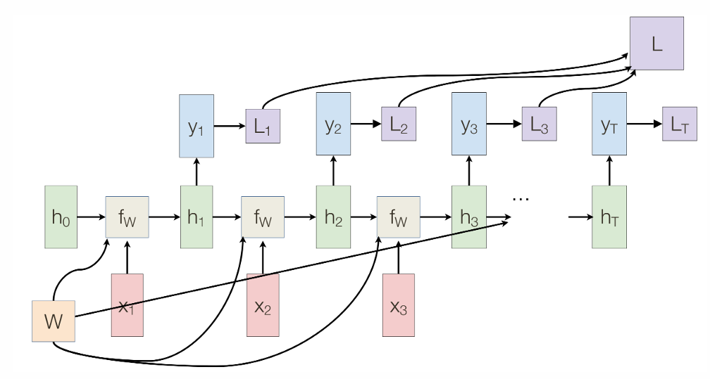
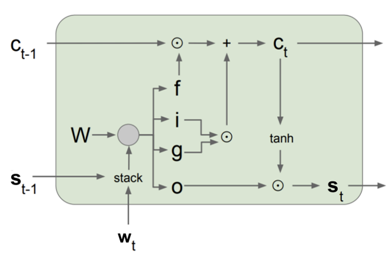

经过大量 CV 领域的了解，我们已经对卷积神经网络有了较为深度的理解，并且领略了各种基于卷积的神经网络以及它们的设计理念。而自然语言处理领域又是另一番景象，由于语言是一个序列，注重顺序，而图像是一个矩阵，因此它们的处理方式在最初是有一定差距的。后来随着 Transformer 的诞生，这两个领域逐渐走向了大一统，并由此联系更为密切。但是在这里我们只会介绍这些基础知识：

1. 如何表示词语和句子？
2. 如何搭建模型去分析自然语言？

好消息是这些在我的 FNLP 笔记中都有了。

# 一、词语表示

图像可以用数据表示，可文字没有这种天生的能力。我们希望设计一种编码方式，能够用向量表示文本，同时能提取词汇的特征。

**One-hot Encoding** 独热向量非常暴力，假如词典中有 $N$ 个词，那就每个词用一个 $N$ 维向量表示，向量中只有一个 1，别的都是 0，且对于每个词，1 的位置不同。它的优点是简单，缺点是词典太大就爆炸了。

基于这个编码得到的句子表示方式就是 **BOW**（Bag-of-Words），一个句子里有哪些词，就把对应维度标为 1。为了解决维度太大的问题，又可以简化成两个数组，一个维护“有哪些词”，记录所有含有的词的下标；另一个维护“出现几次”，记录对应的词出现次数。即使优化了向量长度，但问题仍然很大：这种表示方法无法区分词语的位置，也无法体现词语的含义。为了解决前者，有 Bag-of-Bigrams，其中 Bigrams 就是两个词两个词记录，这样就能提升一点点词序理解能力了。

没法表示词语含义的编码方式总归是走不通的，大家还是走向了远离独热向量的路。如果不使用独热向量的话，那么这个向量就需要精心设计了，因此有两条路，一条是手动设计特征向量，缺点就是太麻烦了。另一条就是**可学习的特征向量**，设计一个网络去自动学习。

先看一个比较原始的手动设计想法，它源自于 1954 年提出的分布假说 Distributional Hypothesis：上下文相似的词，语义也相似。也就是说，一个词语的上下文其实是一个不错的表示词语的特征。因此我们可以统计一个**联合出现矩阵**，$C[i,j]$ 表示这两个词在一定范围内一起出现的次数。这个问题依旧明显，维度还是很高，与词典大小相当。

我们来举个低维的例子，假如纵向只有两维，分别是 use 和 get，同时我们的联合出现矩阵加上限制，当语料库中出现 `use X` 或者 `get X` 的时候，就在对应的值上加一。这样子统计出来就是个表格：

~|get|use
--:|:-:|:-:
cat|53|3
dog|116|7
boat|60|28
knife|51|86

这样子，每个词语都可以用一个二维向量表示了。那有人就问了，cat 和 dog 不是相近的词语吗，为什么它们的向量 L2 距离和 L1 距离都差这么远？因为这里的差距不能通过距离比较，距离受到词频的影响。正确比较方法是比较向量的角度，就会发现这两个词的方向差不多，因此相似性高。

仍然是基于分布假说，我们考虑走学习的道路，也就是 word2vec。这条道路有两个出名的方法，第一种叫 **CBOW**（Continuous Bag of Words），它的目标是给定前后几个词，要求能预测出中间的词向量；第二种叫 **Skip-gram**，它的目标是给定一个词，要求预测出上下几个词。

CBOW 就很简单，你可以搭一个很简单的模型：

- 输入是上下文的 one-hot，长度为词表大小 $\vert V\vert$；
- 然后一个参数矩阵 $W_{N\times\vert V\vert}$，$N$ 任选（一般为 300），使用 $Wv$ 得到特征向量；
- 然后是一个隐藏层，把上下文的特征向量取平均；
- 再使用 $W'\hat v$ 输出 $\vert V\vert$ 维向量，然后使用你喜欢的损失函数计算损失，反传梯度即可。

当 $W$ 训练完毕以后，你就会发现，第 $i$ 列就是第 $i$ 个词的特征向量，因为 $Wv$ 相当于根据 one-hot 的值提取对应的列。这个模型后来被从数学上证明了它是一个合理的优化，这里就不展开了。

# 二、句子表示

来点贝叶斯公式：

$$
p(w_{1:n})=p(w_1)p(w_2\mid w_1)p(w_3\mid w_1w_2)\cdots
$$

再加点假设，假如每个词都只受前一个词的影响，就是 Bigram：

$$
p(w_{1:n})=p(w_1)p(w_2\mid w_1)p(w_3\mid w_2)\cdots p(w_n\mid w_{n-1})
$$

假如受前 $N$ 个词影响，就是著名的 N-gram 了。那这些概率怎么算，就是通过出现频率。比如，$p(w_2|w_1)$ 就等于这两个词一起出现的次数，除以 $w_1$ 出现的次数。单纯从条件概率的定义解释也可以，就是当 $w_1$ 出现的时候，有多大的频率后面跟的是 $w_2$。反正挺好理解的。

现在的目标就是，给定了前面的所有单词，能不能设计一个网络，精准预测下一个词是什么。这个任务的问题就在于它是一个序列问题，也是与 CV 领域最大的区别。接下来你所见到的所有模型，不管是长什么样，都遵循下面两个原则：

1. 允许可变长度的序列输入输出；
2. 还得保证参数量稳定。

这两句话整合成一句话，就是：

# 三、参数共享的序列神经网络

## 1. RNN

RNN（Recurrent Neural Network） 的全部奥秘就在于，不管你输入多少次，我的参数永远固定，一个公式总结就是

$$
h_t=f_W(h_{t-1},x_t)
$$

其实你看这个公式也没啥神秘的，就是根据之前的状态，以及新的输入，给一个输出，然后更新状态。它的精髓就在于参数共享，大家一定要注意这一点。假如把这个函数展开，就得到 Vanilla RNN：

$$
h_t=\tanh(W_{hh}h_{t-1}+W_{xh}x_t+b_h)
$$

这个公式也不复杂，其实就是对 $h_{t-1}$ 和 $x_t$ 分别线性变换，套一个 $\tanh$ 罢了。注意到现在还没有输出，那再套个线性层 $y_t=W_{hy}h_t+b_y$ 就完事了。

    

上图展示了 RNN 的多输入多输出的计算流程，每一步的 $f_W$ 共享一套参数，然后更新参数的时候，仍然是计算 Loss，梯度更新即可。

在训练的时候，我们就按照顺序，此时已知 $x$，我们**逐个**计算出 $h$，然后可以**并行**根据 $h$ 计算 $y$，得到输出以后根据交叉熵损失进行梯度反传等操作。

在测试的时候，我们就不一定能并行了，可能需要按顺序先计算出 $y_1$ 得到输出，然后才能知道 $x_2$ 是什么，这种情况就老老实实计算就行了。

在推理过程中我们可以引入一些变体。比如，在输出头加入一些随机扰动，可能让模型输出更加多样化；直接取 argmax 可以保证模型输出的稳定性；**Beam Search** 可以尝试得到最好的结果。所谓 Beam Search 是在输出的时候，不取唯一的最大值，而是保留多个输出，然后一路接着向下算，保留整体最优的结果。

RNN 有一个和 BatchNorm 类似的问题，训练和测试流程会有区别。在训练的时候，我们保证每一步输入一定是对的；但是测试的时候，输入可能是前一个的输出。说白了这多大点事啊，我训练的时候，有时候输入标准答案，有时候输入前面的预测值不就好了。但是这个“有时候”有点太玄乎了，我们保证前期高概率输入标准答案，后期慢慢增加输入预测值的概率。这一操作能够使得即使前一步错了，后一步仍然可能正确。就这么点事仍然拿下了 NIPS 2015。

当序列很长的时候，Loss 可能需要积累很久才能进行反传，为了增加效率，我们大可以进行一部分输出以后，马上更新一下参数，以便于后续尽快用上新的参数。

RNN 有一个最为严重的问题，就是，经过一顿超级爆算，推导出在远处的损失带来的梯度传递是一个指数级的计算。也就是说，它要么带来梯度爆炸，要么梯度消失。这就直接导致大家必须对 RNN 进行优化。

## 2. LSTM

来点 1997 年的神经网络，我真是第一次知道它这么古老，还是个 90 后。我们这里随便了解下，首先看看它的计算方式：

$$
i_t=\sigma(m_{w_t}U_i+s_{t-1}W_i+b_i)\\
f_t=\sigma(m_{w_t}U_f+s_{t-1}W_f+b_f)\\
o_t=\sigma(m_{w_t}U_o+s_{t-1}W_o+b_o)\\
g_t=\tanh(m_{w_t}U_g+s_{t-1}W_g+b_g)\\
c_t=f_t\odot c_{t-1}+i_t\odot g_t\\
s_t=o_t\odot\tanh(c_t)
$$

其中 $m_{w_t}$ 是当时的输入，$s_t$ 是短期记忆，$c_t$ 是长期记忆。然后给张图，不然看公式有点复杂：

    

最后我们看看它的整体思路。整体思路是这样的：首先对词向量和短期记忆进行运算，得到了不受长期记忆影响的，反映当前词比重的值。然后，我们有三个门：$i$ 是 input gate，表示有多少要写入长期记忆；$f$ 是 forget gate，表示前面的长期记忆有多少要被擦除；$o$ 是 output gate，表示要输出多少内容；以及一个候选记忆 $g$，这是需要被写入长期记忆的内容。反正就是，我们的输入被兵分四路，有三个去影响了长期记忆，还有一个等待长期记忆来支配它，长期记忆被更新后，就对输出进行调整，然后就得到了 $s_t$。

接着我们调整 cell state，先拿 $f_t$ 去遗忘一些内容，也就是 $f_t\odot c_{t-1}$。然后加上应当写入的内容，也就是 $i_t\odot g_t$，就得到了新的长期记忆。请注意 $c_t$ 的更新是通过加法实现的，这是梯度能沿时间传播而不消失的关键。

最后把长期记忆经过一个激活函数，然后与输出门做点乘，轻松得到输出。

其实上面这个机制，说白了你只需要关注两个记忆是怎么更新的，然后有三个门是影响长期记忆，有一个门是影响短期记忆，这四个门的制造过程如出一辙，所以也没那么难记。

LSTM 通过引入了长期记忆这条新路，再玩一通梯度爆算，可以发现长期记忆的梯度比较稳定，并且它还能保留长期的内容，因此性能比 RNN 好很多。其实我们看到 $c_t$ 这条路上面有加法就该意识到这里会比较稳定了，其实和 ResNet 有异曲同工之妙。

至于一些其他的模型就不讲了，本质思想都是一样的。

# 四、图神经网络

为什么在这里讲，其实跟 NLP 没有特别大的关系，但是它中间的循环处理思想和 RNN 比较像，而且后面也需要用到，因此就放在这里了。大家可以随便看看。

现在我们的目标是，给定一个图，它包括：

- 顶点集 $V$；
- 相邻矩阵 $A_{|V|\times|V|}$，每个元素为 0/1 表示两个顶点是否相邻；
- 每个顶点的特征 $X$，或者特征向量 $Y$；
- 等等……

在这个图中，相邻的结点会互相传递信息，互相影响。希望得到一个神经网络，它能分析清楚不同顶点间的连接关系，以及传递信息的情况。这里的问题和 NLP 很类似，你压根就不知道一个顶点有多少个邻居，也就很难用一个网络去处理好。那么怎么办呢，下面简单介绍三种方法。

第一种来自 2005 年，叫做 Average Pooling，简单来说就是加权平均完事。公式是这样的：

$$
h_v^k=\sigma\left(W_k\sum_{u\in N(v)}\frac{h_u^{k-1}}{|N(v)|}+B_kh_v^{k-1}\right)
$$

这个真不复杂，你想知道 $v$ 结点在 $k$ 时间步下的信息，那就是自己在先前的信息，加上相邻结点信息的平均，然后线性相加，套个激活函数即可。

第二种来自 2017 年，叫做 Graph Convolution Network，听起来很牛逼，其实就是把上面这个公式合并了一下：

$$
h_v^k=\sigma\left(W_k\sum_{u\in N(v)\cup v}\frac{h_u^{k-1}}{\sqrt{|N(v)||N(u)|}}\right)
$$

这里还是对不同的时间步有不同的参数，不过如果你想全程相同参数，为了预防梯度出问题，还是得使用更稳定的模型，比如 Gated Graph Neural Network（2016）就使用了 GRU：

$$
\begin{align*}
h_v^k&=\text{GRU}(h_v^{k-1},m_v^k)\\
m_v^k&=W\sum_{u\in N(v)}h_u^{k-1}
\end{align*}
$$

这些也不是课程重点，所以大概了解下思想就好了。