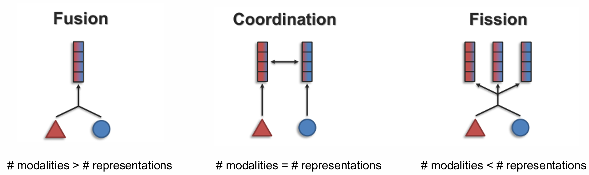
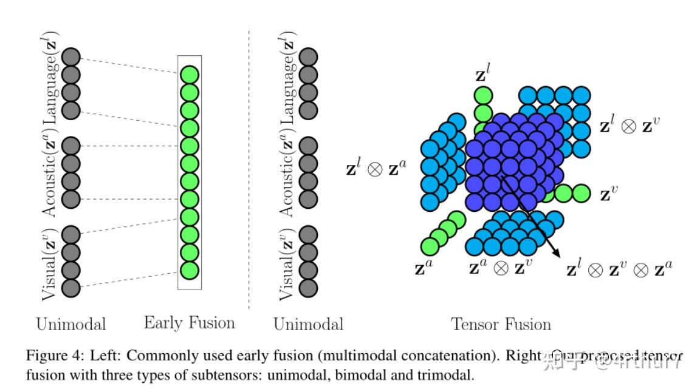
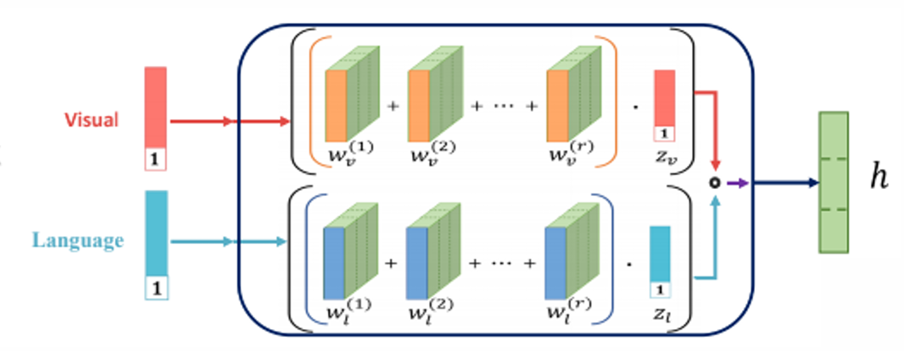
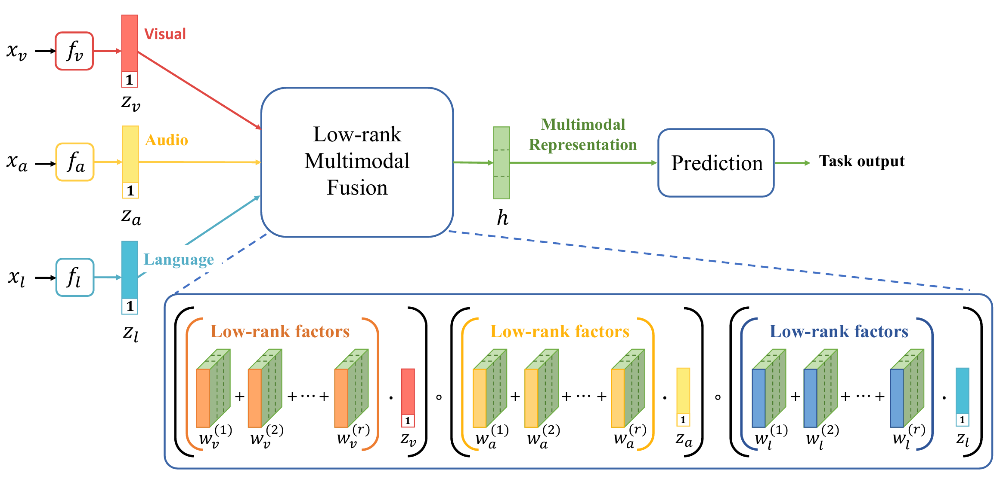
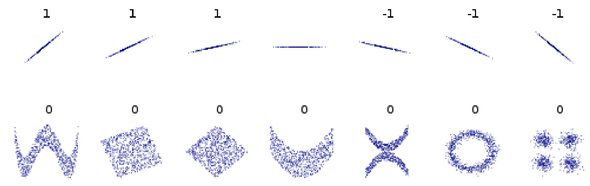
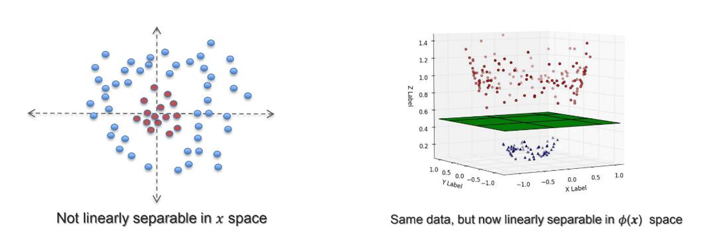
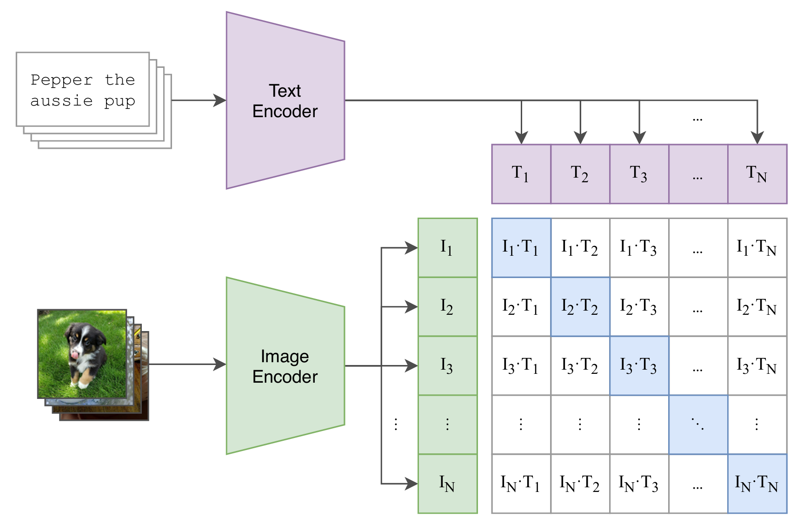
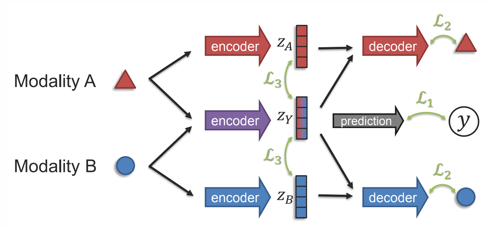
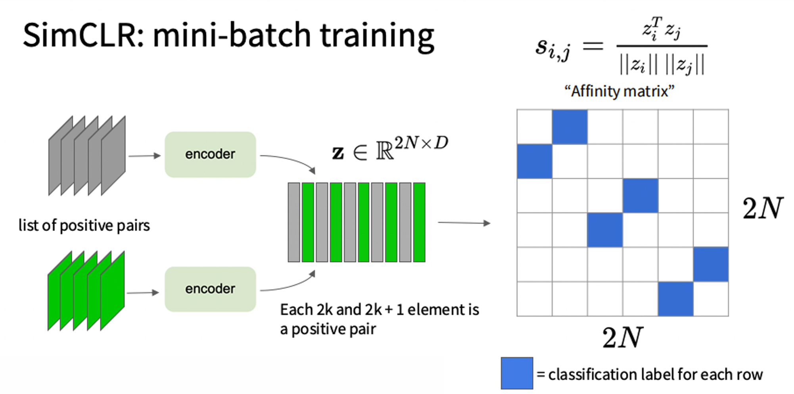
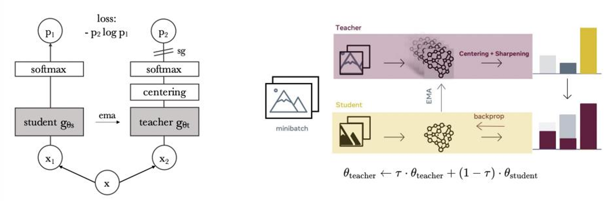

现在我们正式进入多模态的学习，多模态的五大难点是：

- Representation 表征
- Alignment 模态对齐
- Translation 模态转化
- Fusion 合并
- Co-Learning 联合学习

在这一章，我们先来看模态的表征是如何实现的，不过 Fusion 在表征中也是很常用的，所以一并讲了。经过之前的学习，我们已经知道表征的重要性了，它是把多种模态统一成数据，再由机器学习方法去处理的基础，因此非常重要。

# 一、表征的定义和基础方法

多模态学习的表征不仅需要能够编码成向量、表示信息的特征，还必须能够反映不同模块间的关系。常见的方案包括以下三种：

- Fusion 融合，表征个数少于模态数。它的思路是，把两个模态的信息融合在同一个向量中，再进行处理。
- Coordination 协调，表征个数等于模态数。它的思路是，两个模态各自有一个受到其他模态影响的表征，进行一定的信息融合后，再进行处理。
- Fission 分裂，表征个数多于模态数。它的思路是，对信息进行解耦，把两个模态共同的信息提取出来，再把两个模态独有的信息提取出来。

    

# 二、Fusion

融合方向的出发点是，当你只看一个模态的信息时，可能证据不足；但是如果把多个模态的信息结合起来，很有可能就排除了一定歧义性，得到了置信度更高的答案。

## 1. 先编码，还是先融合

图像是像素矩阵，文本是离散序列，直接放在一起处理并不容易。常见方法是先经过各自的编码器：$x_A=f_A(A),\ x_B=f_B(B)$，再计算联合表征 $z=F(x_A,x_B)$。编码器可以预训练，也可以和融合模块一起训练。

那么如何进行融合呢，根据融合时期的早晚，我们有两个融合时期。**Early Fusion** 通常先拼接输入或特征，再交给共同模型；**Late Fusion** 则先独立预测，再对预测结果加权、投票或组合。前者有机会学习细粒度交互，后者实现方便，但如果只保留类别概率，许多原始特征关系就已经丢失了。

## 2. 简单的融合方法

现在的问题是如何实现融合函数 $F$。最简单的方法肯定是线性变换。现在假设输入两个向量 $x_A,x_B$ 分别表示两个模态，那我们简单来点加法：$z=w_1x_A+w_2x_B+\epsilon$，其中 $\epsilon$ 是统计模型中的残差。也可以来点乘法：$z=w_3(x_A\odot x_B)+\epsilon$。还可以把这俩加起来，得到线性回归方法：

$$
z=w_0+w_1x_A+w_2x_B+w_3(x_A\odot x_B)+\epsilon
$$

前两项描述各自的贡献，乘积项描述“一个输入是否会改变另一个输入的作用”。

在这个简单的模型上，我们还可以简单变化一下，可以用的操作包括：

- **拼接**：$z=[x_A;x_B]$，保留原始信息，让后续网络学习关系。
- **加法**：$z=f_A(A)+f_B(B)$，需要两路输出维度相同，也希望对应坐标具有可比较的意义。
- **逐元素乘法**：$z=x_A\odot x_B$，只让对应坐标交互。维度不同时可以先投影。
- **外积**：$Z=x_Ax_B^\top$，让 $A$ 的每个特征与 $B$ 的每个特征交互，得到矩阵。

## 3. TFN

纯外积只包含交互项，没有显式保留原来的两个向量。这里有一个小操作叫 **Tensor Fusion Network**（EMNLP 2017），就是你可以在每个向量后面加上一个 1，此时再乘法就会发现，得到的矩阵既有融合特征，又保留了原来的特征。下图展现了三个模态融合得到的结果，可以通过不同的颜色看出它融合了几个模态的信息：深蓝色融合了三个模态、蓝色融合了两个模态、绿色保留了原始的信息。

    

## 4. Low-rank Fusion

TFN 的问题是维度增长太快。设 $M$ 个模态补 $1$ 后的维度为 $D_1,\ldots,D_M$，完整外积有 $\prod_mD_m$ 个元素；再映射为 $d_h$ 维输出，稠密权重需要约 $d_h\prod_mD_m$ 个参数。很明显当模态数一多，这个网络立马就爆炸了。

**Low-rank Multimodal Fusion model**（ACL 2018）通过矩阵的拆分来达到这一效果。这里的数学推导比较复杂，我们先从两个模态、一个输出的情况开始。令补好 $1$ 的输入为 $a\in\mathbb R^{D_A},b\in\mathbb R^{D_B}$，原计算是先外积 $ab^T$，摊平以后乘以权重 $W$，经过一段数学计算以后得到 $h=a^\top Wb$。

$$
\begin{align*}
h&=\sum_{i=1}^{D_A}\sum_{j=1}^{D_B} w_{ij}z_{ij}\\
&=\sum_{i=1}^{D_A}\sum_{j=1}^{D_B} w_{ij}a_ib_j\\
&=a^\top Wb
\end{align*}
$$

然后大家知道，根据奇异值分解，任何矩阵都能拆成若干个秩一矩阵之和。如果按照奇异值从大到小，抛弃掉后面一些项，我们就可以用 $r$ 个秩一矩阵**近似**权重：$W\approx\sum_{i=1}^ru_iv_i^\top$，其中 $u_i\in\mathbb R^{D_A},v_i\in\mathbb R^{D_B}$。因此有：

$$
\begin{aligned}
h&=a^\top Wb\\
&\approx a^\top\left(\sum_{i=1}^ru_iv_i^\top\right)b\\
&=\sum_{i=1}^r(a^\top u_i)(v_i^\top b).
\end{aligned}
$$

现在每个秩分量只需要算两个内积，再把结果相乘，最后加起来即可。原来的 $D_AD_B$ 个权重，变成 $r(D_A+D_B)$ 个，在 $r$ 较小时节省很多。下图表示了拆分后的计算方式，可以看到，我们把 $W$ 拆成了几个向量，这一步的基础就是奇异值分解。

    

推广到多个模态和 $d_h$ 维输出，也就顺理成章了。为第 $m$ 个模态、第 $i$ 个秩分量设置投影 $U_m^{(i)}\in\mathbb R^{d_h\times D_m}$：

$h\approx\sum_{i=1}^r\left[(U_1^{(i)}\tilde x_1)\odot\cdots\odot(U_M^{(i)}\tilde x_M)\right]$。

也就是：**各模态先投影，同一秩分量逐元素相乘，然后对秩求和。** 主要参数量变成 $r d_h\sum_mD_m$，固定秩和输出维度后，对模态数呈线性增长，极大降低了参数量。总结一下就是，通过使用低秩近似这个操作，用一个估计换了参数量下降，还是挺赚的。

    

## 5. 添加门控信号的融合

前面几种操作对每个样本使用同样的融合规则，但有的图片很清楚，有的声音很嘈杂，模态的重要性应当随输入改变。因此我们考虑加入一些门控操作，比如 **Gated Fusion**。简单来说就是添加了门控函数 $g_A,g_B$，根据两个模态的信息去输出门控权重，也就是 $z=g_A(x_A,x_B)\cdot x_A+g_B(x_A,x_B)\cdot x_B$。其实就有点像 Attention 的思路了，毕竟 gated 是把不需要的信息排除，attention 是关注重要的信息，本质是一样的。因此也有人把这个操作叫 Attention Module。这里又分为两类，**Soft Attention** 使用连续权重，通常便于反传；**Hard Attention** 做离散选择或采样，普通梯度无法直接穿过选择操作，可能需要梯度估计等方法。

有了 Gated 操作以后，就可以力大砖飞，比如 **Dynamic Fusion**，先准备单模态、加法、双线性等多个候选分支，再套一个门控函数，据输入决定各分支的权重，说白了也没啥创新。

## 6. 用重建任务学习融合表征

再进一步，有人尝试借鉴 AutoEncoder 的思想，发明了 **Multimodal Autoencoder**。这何止借鉴啊，几乎就纯抄了，将两路输入编码为共享表征 $z$，再用两个解码器分别重建输入，例如 $\mathcal L_{\rm rec}=\|x_A-d_A(z)\|_2^2+\|x_B-d_B(z)\|_2^2$。这种网络不依赖人工类别标签也能学习，而且还有点惊喜：利用配对数据学习共同空间后，可以实现在一种模态上训练分类器，然后到另一种模态上测试，效果还不错。

## 7. 总结

上面我们介绍了加性融合、乘法融合、后面补一个 1 的 Tensor fusion、解决参数量爆炸而推导出的低秩融合、加入门控的 Gated fusion 和 Dynamic fusion，以及最后的 Autoencoder，看看大家还有没有印象。

这些融合方式无一例外，都需要先将模态编码成向量，化成同一形式后再处理。而如何实现原始模态融合，仍然是一个待研究的问题。

# 三、Coordination

协调的想法就比较朴素了，我们仍然保留对两个模态分别编码的操作，但是我们同时设计一个衡量两个模态相关性的损失函数，作为整个学习的任务之一。模型在完成原有任务的基础上，还得尽可能让语义相关的模态之间的表征更加接近。经过这样的学习，可以实现：跨模态的语义相似的内容，经过不同编码后得到的向量较为接近。

## 1. 朴素的衡量相关性的函数

第一个就是**余弦相似度**，这个高中就学过了。

$$
g(z_A,z_B)=\frac{z_A\cdot z_B}{\|z_A\|\cdot \|z_B\|}
$$

还有**相关性**，也是高中学过的：

$$
\rho_{X,Y}=\frac{cov(X,Y)}{\sqrt{var(X)var(Y)}}
$$

以防有人忘记了，分子是协方差，$cov(X,Y)=\sum(X_i-\mu_x)(Y_i-\mu_y)$。这里我们把向量看做一组数据，其实把向量减去它自身的均值后，余弦相似度等价于相关性。相关性衡量有什么问题呢，请看下面这张图。这些散点的横坐标是 $X$，纵坐标是 $Y$，第一行所有的分布都是高度线性的，因此相关性是 1，但是这些情况并不一样。同时，第二行所有分布的相关性都是 0，但是很明显它们都是有一定关联的。这就说明相关性并不是很准确。

    

第二个操作是**核函数**，它先对特征进行映射，然后再度量空间衡量相似性：$k(x,y)=\langle\phi(x),\phi(y)\rangle$。这里的 $\phi$ 会把 $x$ 映射到高维空间，因此可以让一些不是线性相关的数据以线性相关的形式表示。比如下面这张图，原本红蓝数据（注意这里的每个点表示一个数据，和上面的图不一样了）的关系是，前者离中心点近，后者离中心点远。人眼能看出来，但是它没有线性关系，用相关性就发现不了。经过核函数映射，右边这张图的 $z$ 轴就能发现这个关系了。一个著名的核函数是 **RBF 核**（Radial Basis Function Kernel）：$k(x,y)=\exp(-\frac{\|x-y\|_2^2}{2\sigma^2})$，通过距离远近判断相似度，$\sigma$ 控制“多远还算相似”。

    

## 2. CCA

同样是为了解决非线性相关的问题，再结合相关性，就有了 **CCA**（Canonical Correlation Analysis，典型相关分析）。它不直接比较原向量，而是分别寻找投影 $u,v$，让 $u^\top X$ 与 $v^\top Y$ 在配对样本上尽量相关。我们做一些数学推导，设 $X,Y$ 已中心化（均值为零），$\Sigma_{XX}=\mathbb E[XX^\top]$、$\Sigma_{YY}=\mathbb E[YY^\top]$ 是各自的协方差矩阵，$\Sigma_{XY}=\mathbb E[XY^\top]$ 是交叉协方差矩阵，则我们希望找到两个投影，使得下面这个式子最大化：

$\displaystyle\max_{u,v}\operatorname{corr}(u^\top X,v^\top Y)=\max_{u,v}\frac{u^\top\Sigma_{XY}v}{\sqrt{u^\top\Sigma_{XX}u}\sqrt{v^\top\Sigma_{YY}v}}$。

为了尽可能学到更多的投影，我们希望不同的投影对是正交的，因此把协方差矩阵 $u^T\Sigma_{XY}v$ 的非对角线设成 0。此时 $U\Sigma_{XY} V$ 的行列式的值就等于它的迹。

最后，由于这个方程对放缩不变，我们可以限制分母的映射都是恒等映射，也就是分母全都是单位矩阵，因此优化目标可以改成下面这个表示：

$$
\begin{aligned}
\max_{U,V}\quad&\operatorname{tr}(U^\top\Sigma_{XY}V)\\
\text{s.t.}\quad&U^\top\Sigma_{XX}U=I,\qquad V^\top\Sigma_{YY}V=I.
\end{aligned}
$$

真是酣畅淋漓的数学推导，我觉得我完全记不住。一个经典的使用该算法来训练多模态表征的模型叫做 **DCCAE**（Deep Canonically Correlated Autoencoders）。它的基础结构就是两个 AE，使用编码器分别编码两个模态，同时用解码器还原。而优化目标不只有还原，还要求中间的特征向量满足 CCA 的优化目标。

## 3. 对比学习与 CLIP

前面的三种方法是表示向量相似度的方法，现在我们就开始基于这个方法训练模型。对比学习的目标很简单，我们要使相似的表示靠近，不相似的表示拉开。

首先我们需要准备很多的样本对 `(modal1, modal2)`，同时标清楚正负。然后编码成向量 $z_A,z_B$。现在就可以定义损失函数了，最简单的定义方法就是，负样本的相似度减去正样本的相似度。再加个 $\alpha$ 表示阈值，必须让这个差距超过阈值才算满意，因此公式是 $\max(0,\alpha+sim(-)-sim(+))$。这里的 sim 函数想选什么就选什么。

问题有二，第一是这个方法必须采样一些负样本，但是怎样采出负样本呢，历史上有很多采样策略，但是都很麻烦；第二是不管你采样的数量，阈值始终是 $\alpha$，这很明显效果不好。因此后面变成了 **InfoNCE**：

$$
\mathcal L=-\frac{1}{N}\sum_{i=1}^N\log\frac{sim(z_A^i,z_B^i)}{\sum_{j=1}^N sim(z_A^i,z_B^j)}
$$

首先明显减法变成了除法，其次可以看到，这里不再标记正负样本，而是选了 $N$ 对表征 $z_A^i,z_B^i$，只认为匹配的表征是正样本，其他不匹配的全都是负样本。

这个损失函数很直白，但是非常好用，基于这个损失值就直接发明了 **CLIP**（Contrastive Language Image Pre-training，ICML 2021）。它收集了四亿图文对，用 256 块 V100 训练了 12 天。它的第一步就是使用对比学习进行预训练，整个实现就非常简单，对于每个 batch，假设有 $N$ 个文本和 $N$ 张图片一一对应，把文本和图片输入给 encoder 得到向量，然后两两配对，然后计算相似度，得到下图中的大矩阵。矩阵中只有对角线是正样本，其他都是负样本，使用 InfoNCE 去计算损失值就完事了。最后训练出来的两个 encoder 就是同时考虑到图像和文本的编码器。

    

我不知道多少人把 CLIP 当做自己在多模态领域心中的白月光，反正我是有点，结果一看这实现也太简单太暴力了，凭啥这么出名啊？它肯定还是有它的过人之处的。第一就是它纯粹的暴力美学，在训练中作者把 batchsize 开到了三万多，大家都知道这里的 batchsize 越大，正负样本的数量就越多，训练质量也更好。如此暴力的操作直接导致该预训练模型的超高质量。

第二是它可以完全不微调，就直接拿去做其他任务，比如图像分类任务等等。这是怎么做到的呢，假如现在有 20 类，包括 `cat, dog, bird...` 等等。那么我全部封装成文本：`A photo of a {object}`，然后输入进 Text Encoder，得到 $T_1-T_{20}$。同时把图片输入进 Image Encoder，得到 $I$。然后计算相似度，取最相似的文本作为预测值就好了。其他任务也差不多，反正就是设计一个 prompt，再去查相似度就好了。作者贴心设计了 80 多个 prompt，适配各种任务。为啥非得封装成 prompt 呢，因为训练中用的都是句子而非单词。那如果我希望做更细粒度的分类呢，比如我想分类各种狗，只需要再在 prompt 前面加上“现在我在做狗的分类”即可，非常神奇。

CLIP 在 27 个数据集上进行了测试，打败了一大半在对应数据集上进行了全监督训练的顶尖模型，相当于它们苦练对应功法，被一个邪修弟子挥挥袖子秒了。进一步微调之后，还可以让这个模型稳定涨点，而且这个微调甚至不需要用到原数据集的全部类别，拿 4 个以上的类别去微调就能稳定涨点了。这大概率是因为原来预训练的文本数据集太庞大了，很可能附带了没有见过的类别。而 4 个以下就不太好，可能是因为一个学识渊博的老师看了一点点歪门邪道，被这些样本骗得过拟合了。

# 四、Fission

Fission 最简单的想法是希望既提取两个模态共有的信息，也保留两个模态独有的信息，也就是进行一个解耦。**Modality-level Fission** 将信息分为共享部分 $s$ 与模态私有部分 $p_A,p_B$；**Fine-grained Fission** 进一步分解更细的因素，而不只按整个模态划分。

那怎么搭模型呢？我们可以直接搭三个编码器，得到三个向量。然后对于两个单模态信息，可以尝试重构原模态信息，来证明这个独有的信息没有发生丢失；对于融合信息，我们可以设计一些需要考虑融合信息的问题，然后使用该向量进行预测。

    

这个模型需要结合三类约束：

1. **判别损失**：利用表征预测下游标签，保证任务相关性。
2. **生成或重建损失**：用 $(p_A,s)$ 重建 $A$，用 $(p_B,s)$ 重建 $B$，保留各模态内容。
3. **分离约束**：通过先验、去相关或独立性约束等方式，减少共享与私有部分的重复编码。

整体可以写成 $\mathcal L=\mathcal L_{\rm task}+\lambda_{\rm rec}\mathcal L_{\rm rec}+\lambda_{\rm sep}\mathcal L_{\rm sep}$。

## 1. 从信息论的角度看 Fission

一个消息越出乎意料，携带的信息越多。自信息定义为 $I(x)=-\log p(x)$，而**熵**是自信息的期望：$H(X)=-\sum_xp(x)\log p(x)$。这里的“信息多”表示不确定性大，不等于对任务有用。那么对于一个模态，它能提供的信息量就是它的熵。

两个模态（比如对应的图文）的信息量一般肯定有交叉，**条件熵** $H(Y\mid X)=-\mathbb E_{X,Y}[\log p(Y\mid X)]$ 表示知道 $X$ 后，$Y$ 还剩多少不确定性。对应的部分就是 Y 模态提供的独有的信息。

**互信息**衡量知道一个变量后，另一个变量减少了多少不确定性，其实就是两个信息的共有区域：

$$
\begin{aligned}
I(X;Y)&=H(X)-H(X\mid Y)\\
&=\mathbb E_{X,Y}\left[\log\frac{P_{XY}(x,y)}{P_X(x)P_Y(y)}\right]\\
&=D_{\rm KL}\bigl(p(x,y)\,\|\,p(x)p(y)\bigr)
\end{aligned}
$$

而我们 fission 的主要目标，其实是希望得到的融合表征 $z$ 越靠近两个模态的互信息越好，因为融合表征是所有表征中最重要的部分。这就有两个思路，一个是最大化 $z$ 与两个模态的互信息，另一个是最小化已知模态后 $z$ 的条件熵。第一种思路其实可以走对比学习的道路，把 $z$ 和它对应模态的样本当做正样本对，与其他样本当做负样本对，然后进行训练，这样我们又不需要标注样本了，完全可以自监督学习，非常爽。它的目标是让融合表征能够充分获取每个模态的表征。而第二种思路的目标不一样，它希望仅给出一种模态时，$z$ 的不确定性尽可能小。一般会把这两个优化方式加权使用。

# 五、自监督学习

下面讲的好像不是多模态的表征了，而是三种自监督学习的方法，它们的目标都是构建不需要手动标注标签的可学习模型。

## 1. Sim CLR

SimCLR（IMCL 2020）的算法很简单，对于一个 batch 的图片，都进行两种不同的数据增强，然后交错排列。接着和 CLIP 一样，算相似度矩阵，此时我们希望同一张图片的两种变体的相似度较高，也就是下图中蓝色区域的值；而其他白色的，除了对角线上的值，都是负样本。这里训练出的 encoder 是用于单模态的。

    

这里用到了一个思想，就是通过数据增强去获得用于对比学习的正样本。对于一张图，我们可以裁剪、旋转、图像变换等操作，获得大量的正样本。而且你压根不需要关心图片本身的含义，你只要知道它处理以后和原图需要等价就行了。同时这篇文章在数学上证明了 InfoNCE 这个损失值恰好是所有样本与正样本的互信息的一个下界，也就是说这个损失值在数学上证明了正样本有多能代表总样本。而且该下界的紧度与负样本的数量有关，越多越紧，这也证明了为什么 batchsize 越大越好。更多数学内容请搜索原文。

## 2. DINO

**DINO**（ICCV 2021）同样是用于训练图片 encoder 的方法。它的思路是，我们有两个模型，一个作为 student，另一个作为 teacher。我们的目标就是，让学生的输出尽可能拟合老师的输出分布，也就是使用交叉熵损失。但是，学生是直接学习的，计算出 loss 以后反传梯度训练。而老师不进行梯度反传，它是在学生的更新基础上进行微量更新：$\theta_T\leftarrow\mu\theta_T+(1-\mu)\theta_S$。这个思路是，老师的梯度更新更轻微，这就相当于老师在同一个状态下看到了更多的 batch，因此可以给 student 提供更好的目标，同时由 student 快速学习并更新老师。

    

它相对于 SimCLR 的好处就是，尽可能规避每个样本对 batch 中其他样本的依赖。这个设计也使得 DINO 是一个极具泛化性的模型。

## 3. MAE

前两个方法是走对比学习的路，而下面这个方法是希望走重构的路。**MAE**（Masked AutoEncoder）顾名思义就是在原本的 AE 上加了掩码。首先随机对图片加掩码，遮掉一部分，然后目标是希望即使这样，模型在 encoder-decoder 之后仍然能复原整张图片。最终的效果是即使 mask 掉原图的 75%，仍然有较好的效果。

## 4. Pretext Task

上面三种方法，都是通过定义了一个**只依赖数据本身，而不需要具体类别**的任务，来规避手动标注标签的操作，这种任务叫做 **Pretext Task（代理任务）**。比如下面这些任务：

| Pretext Task  | 怎样自动构造监督                                              | 希望学到什么             |
| ------------------------ | ------------------------------------------------------------- | ------------------------ |
| Rotation Prediction      | 随机旋转 $0^\circ,90^\circ,180^\circ,270^\circ$，预测旋转类别 | 物体方向与整体结构       |
| Inpainting               | 遮住图像区域，预测缺失内容                                    | 局部上下文与物体组成     |
| Jigsaw Puzzle            | 打乱图像块，预测空间排列关系                                  | 部分与整体的位置关系     |
| Colorization             | 由灰度或 Lab 的 $L$ 通道预测色彩 $ab$ 通道                    | 物体类别与颜色的统计关系 |
| Cross-channel Prediction | 从一组通道预测另一组，如 RGB 与深度通道                       | 不同视图之间的共同结构   |