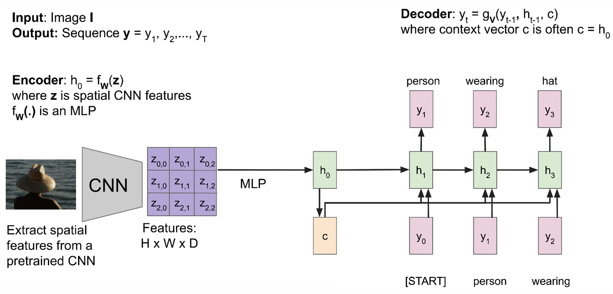
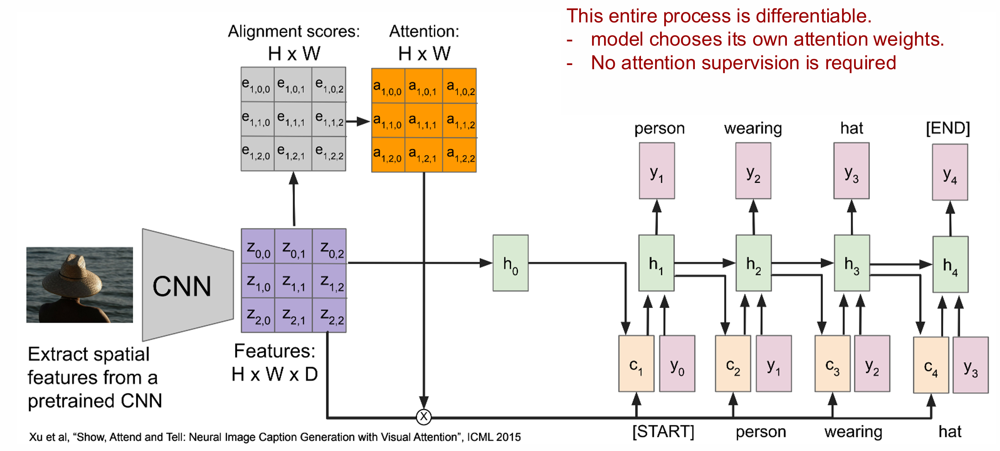
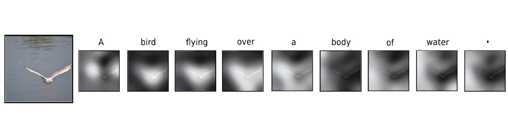
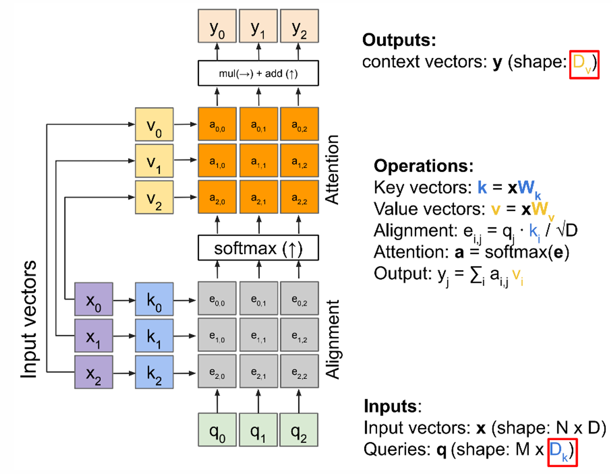
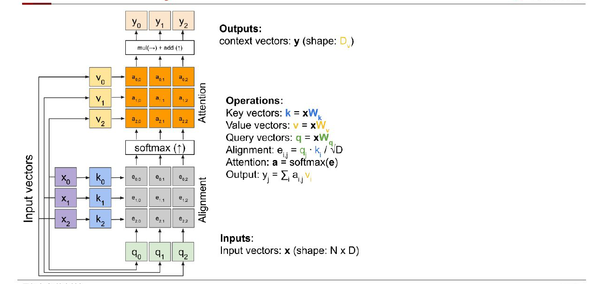
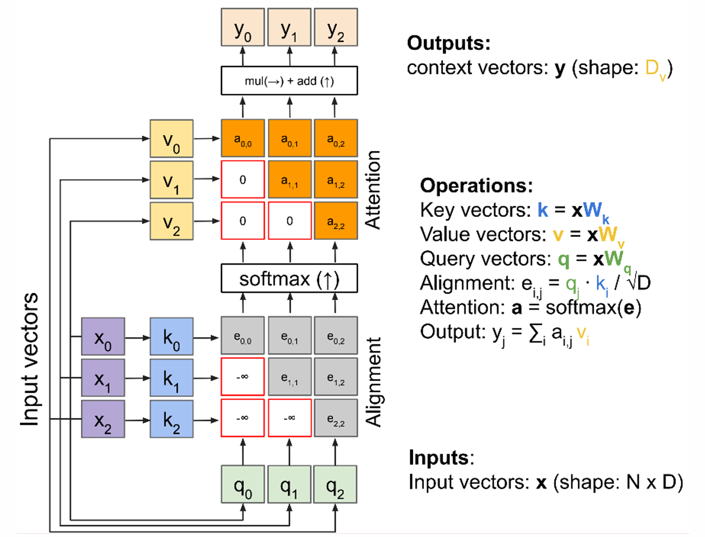
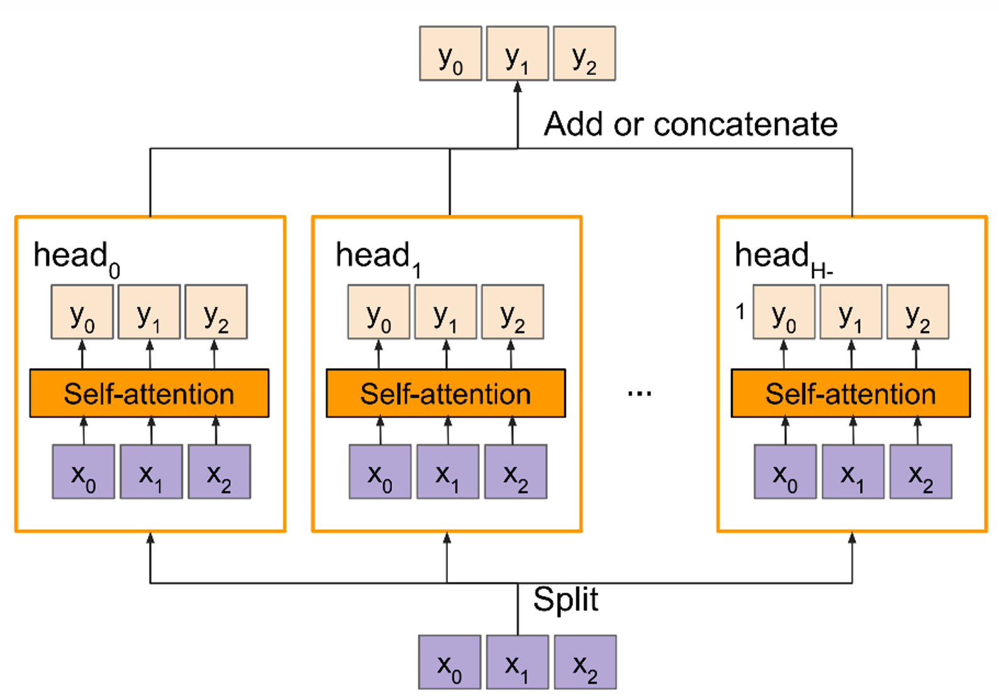
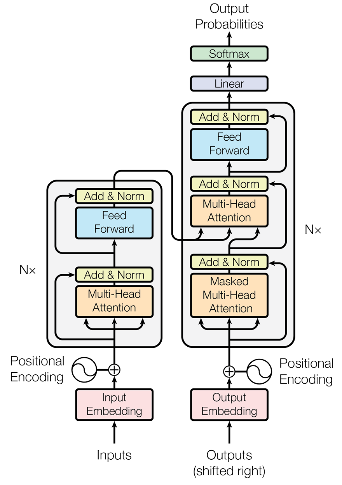
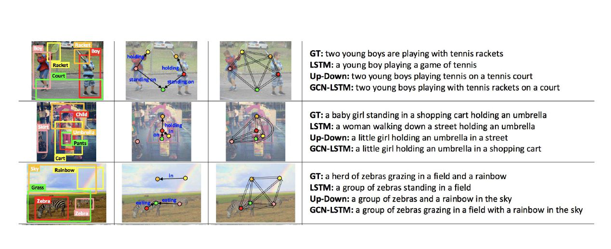

接下来我们了解不同模态间是如何进行对齐的。不管是给定视频输出描述；还是给定视频和音频，找到视频中的发声物体；这些任务都必须要实现模态对齐，进一步完成理解或生成任务。

模态对齐有三种基本形式：

- 离散对齐，两个需要对齐的模态都是离散化的单元，比如视频的单元就是图片，文本的单元就是单词，图片的单元也可能是一些 region。
- 连续对齐，至少有一种模态是连续表示的，没法离散化。比如音频就很难离散化。
- 上下文表示，它是一种隐式对齐，不一定要一一对应起来，但是它的任务需要模型一定程度上进行对齐，比如说 VQA，虽然不需要模型把问题和视频完全对应，但是模型仍然需要能够把两个模态联系起来，才能正确回答问题。

为了实现对齐，如果你已经了解 Transformer 了，你就知道 Attention 机制将在这个任务中杀疯。不过我们还是会先介绍它之前的一些尝试，然后介绍 Transformer 到底解决了它们的什么问题、

# 一、注意力机制

在没有 Transformer 的日子，我们有 CV 领域的 CNN，但是它在长距离的感知不足；同时有 NLP 领域的 LSTM，但是它没法并行计算。

不过虽然有这么些限制，我们还是可以完成一些简单的任务的，我们以 Image Caption 任务为例，为了解决这个任务，首先我们接一个 CNN，把图片变成特征图。然后经过 MLP，把特征图转化为 RNN 的初始状态 $h_0$，同时也保存这个初始状态，记作 $c$。然后就进入 RNN 阶段，每次都输入 $c$ 和前面的词，得到下一个预测词，这样迭代进行。为什么一定要每次都输入 $c$ 呢，就是害怕模型到后面就忘记图片内容了。

    

那它有什么问题呢，问题在于即使你后面每次都输入 $c$，生怕语言部分忘记图片了，但是你提供的终归不是原图，而是先变成特征图，再过 MLP 得到的结果，因此图中很多的内容和性质都丢失了。因此我们的想法是，如果每个隐状态 $h$ 都能**注意到**原特征图的每个位置就好了！

我们引入**注意力机制**（ICML 2015），首先还是正常得到特征以及初始状态 $h_0$，在第一个输出中，我们只需要照常输入 $h_0,y_0$，输出第一个预测词，得到第一个隐状态 $h_1$。从这之后，我们输入的图像信息就不再是 $h_0$ 了，而是基于注意力得到的 $c$。首先使用一个函数 $f_{att}(h_{t-1},Z)$ 来计算在当前的状态下去注意 $Z$ 得到的注意力得分 $e_t$，softmax 之后得到 Attention Matrix。随后，使用它去点积原特征图，得到最新输入的状态 $c_t$。用公式表示就是：

$$
e_t=f_{att}(h_{t-1},Z)\\
a_t=softmax(e_t)\\
c_t=\sum_{i,j}a_{t,i,j}z_{i,j}
$$

注意力函数最经典的就是 $f_{att}(h,x)=\frac{h*x}{\sqrt{D}}$ 了，其中 $D$ 是 $h$ 的维度。除以 $\sqrt{D}$ 的原因是 $h*x$ 的大小受到向量长度影响，越长值就越大，因此我们希望得分不过于集中，再过一个 softmax 就不会使得模型过于关注一个区域。

    

上图就比较清晰了，每个 $c_t$ 都是先计算注意力分数，变成注意力矩阵，再点乘原特征图得到的，因此每次都注意了原特征图。下图用可视化的方式展示了注意力机制的效果，亮处表示当前词对应的高权重区域。以“鸟飞过水面”为例，生成 `bird` 时关注鸟，生成 `water` 时更多关注水面；这就把词和图像区域联系了起来。

    

在上述例子中，我们可以发现，如果你把 $Z$ 的元素全部打乱重排，其实是不影响输出的值的，输出的值也只会按照相应的顺序排列，这种现象叫 permutation invariant 置换不变性。因此在 attention 操作中，我们可以把矩阵直接拉成向量。

现在的 attention 还有一点点小问题，你在计算 attention matrix 的时候是用 $Z$，计算输出还是用 $Z$，我们希望能够有一定的变化，因此套两个全连接层 $K=ZW_k, V=ZW_v$。套上全连接层后，我们甚至可以实现输出的维度变化（因为全连接层可以改变输出维度了）。

这样我们得到了完全体 attention，其中 Query 是 $M\times D_k$ 维向量，也就是有 $M$ 个行向量 $q_0,q_1,\cdots$。$x$ 是需要被注意的特征，Key 是由 $xW_k$ 得到的，把每个向量的维度都降到 $D_k$ 维。然后使用 $e_{ij}=q_j\cdot k_i/\sqrt{D_k}$ 计算对齐度，经过 softmax 得到 attention matrix。最后由 $xW_v$ 得到 Value，再使用 attention 加权得到最终输出，维度是 $D_v$。

    

自注意力机制也就是在这个注意力的基础上，把 $q$ 换成了 $xW_q$，也就是下面这张图。

    

# 二、位置编码

之前我们说到了置换不变性，也就是说无论序列以何种顺序输入，都不影响最终的输出值。这就导致模型无法区分不同顺序的输入，因此我们希望有一个**位置编码**，它能实现：

1. 每个位置的编码是唯一的；
2. 相邻位置的编码是相近的；
3. 不管输入多长，每个位置都能被编码；
4. 编码是确定性的。

第一个想到的方案是用学习的方式学出这样一个 encoding，但是由于要求和限制太多，最终以失败告终。

第二个方案是正弦余弦函数，它就是 Transformer 中使用的编码方式：

$$
p(t)=\begin{bmatrix}
    \sin(w_1t)\\
    \cos(w_1t)\\
    \sin(w_2t)\\
    \cos(w_2t)\\
    \vdots\\
    \sin(w_{d/2}t)\\
    \cos(w_{d/2}t)\\
\end{bmatrix}
$$

其中 $w_k=\frac{1}{10000^{2k/d}},d$ 是输入向量长度。不同维度使用不同频率，可以理解为用不同尺度的“尺子”标记位置。它不需要为每个位置存储独立参数，对训练时没出现过的位置也能计算。这个方案满足上面 1,3,4 的要求，但是 2 显然不太满足，因为位置相近的 $p$ 的欧氏距离还是比较大的。

但是这种编码满足三个重要的性质。一个是**相对位置只依赖坐标距离**。对某一个频率，用三角函数的和角公式可得：

$$
\begin{pmatrix}\sin(\omega(t+\Delta))\\\cos(\omega(t+\Delta))\end{pmatrix}
=\begin{pmatrix}\cos(\omega\Delta)&\sin(\omega\Delta)\\-\sin(\omega\Delta)&\cos(\omega\Delta)\end{pmatrix}
\begin{pmatrix}\sin(\omega t)\\\cos(\omega t)\end{pmatrix}
$$

也就是说，固定偏移 $\Delta$ 对应的矩阵不依赖起点 $t$。进一步，由 $\sin a\sin b+\cos a\cos b=\cos(a-b)$，可以得到第二个性质：**两个位置编码的点积仅取决于偏移量**。

$$
\operatorname{PE}(t)^\top\operatorname{PE}(t+\Delta)=\sum_i\cos(\omega_i\Delta)
$$

第三个性质是，位置编码的点积是无向的，也就是说 $PE_t^T*PE_{t+\Delta t}=PE_t^T*PE_{t-\Delta t}$。不过最关键的性质还是第二个，我觉得应该不会考这个推导吧，没啥意义啊。

# 三、Transformer 最后的拼图

现在我们已经有了两个碎片，一个是 self-attention，另一个是位置编码。接着我们还需要对 attention 做一些调整。

第一个调整是，当你在预测输出时使用 attention，会计算 query 在 key 前面的值，但是实际上你在输出文本，比如 image caption 的时候，前面的词是看不到后面的词的。这个解决起来也很简单，把对应位置的 alignment 分数掩码盖掉就行了。这种自注意力层就是 **Masked Self Attention Layer**。

    

第二个调整是，我们可以把同一组输入放在不同的自注意力层，计算出多组输出后，进行相加或拼接，得到整合的输出，这种自注意力层就叫 **Multi-head Self Attention Layer**。

    

有这些模块我们就能拼成 Transformer 了，不过课件这里好像没讲具体是怎么拼的，那我也不讲了。

我们比较一下 RNN 和 Transformer 的区别：

- RNN
  - 优点 1：在长序列上表现良好
  - 缺点 1：只接受按顺序输入
  - 缺点 2：必须要按顺序完成所有计算
- Transformer：
  - 优点 1：同样在长序列上表现良好，每个位置都会看到它能看到的所有输入
  - 优点 2：可以接受无序输入，也可以加上位置编码以支持有序输入
  - 优点 3：可以并行计算 alignment 矩阵和 attention 矩阵的每个位置
  - 缺点：空间消耗很高，因为要在每个单头注意力中保存整个矩阵。但是随着 GPU 变大，这个问题也不算问题了。

# 四、Transformer 完全体

原来先讲优缺点再讲架构，好好好。

    

里面所有模块都讲过了，也没什么好讲的。

那有人要问了，图像还需要把它过一个 CNN 得到特征图吗？不需要了，只需要把图片分块，再使用 Input Embedding 用图像编码器变成特征向量就行了。

# 五、图像描述优化

在 Image Caption 领域，有很多的研究是盯着 failure case 去做的。比如，有时候模型会把物体弄错，那么我们就使用 Faster R-CNN 进行物体检测，得到了每个候选框被判定为每个类别的概率，以此为特征图进行注意力。使用越强的目标检测器，模型认识物体的能力就越强。

再比如，有时候模型既判别不对物体，也判别不对物体间的关系。这里的处理就比较暴力了，直接罗列所有的关系，比如：

- 20 种语义关系（来自 Visual Genome，比如吃、追赶、依靠……）
- 11 种空间关系（内部、覆盖、左右……）

获得关系后，怎么处理物体之间的关系呢？之前的**图神经网络**就派上用场了（ECCV 2018），首先进行目标检测，然后用这些物体构建两个知识图谱，一个基于语义关系，一个基于空间关系。然后通过两个 GCN（图卷积），提取图的特征，再进行 attention。这个效果还挺不错的，见下图。

    

目标检测已经帮助优化图像描述任务了，还有什么呢？语义分割也行啊，它其实也就是一个结果更加细粒度的目标检测，因此整体的思路和上面是差不多的，也是基于图神经网络进行的。

既然都说了这么多图像描述任务了，那也就顺便介绍下**数据集**，最常用的是 COCO Captions，还有 Flickr 30K。以及测试指标，常用的包括下面四个：

- **BLEU**：基于 n-gram 统计，对句子质量进行评估
- **METEOR**：评估词语的顺序是否合理
- **CIDEr**：基于 n-gram 统计，同时使用 tf-idf 给 n-gram 设置了不同的权重
- **SPICE**：计算 `图像-scene graph` 的 F1 分数

除了图像描述以外，还有很多很多需要对齐多模态的任务，这里就不细说了。