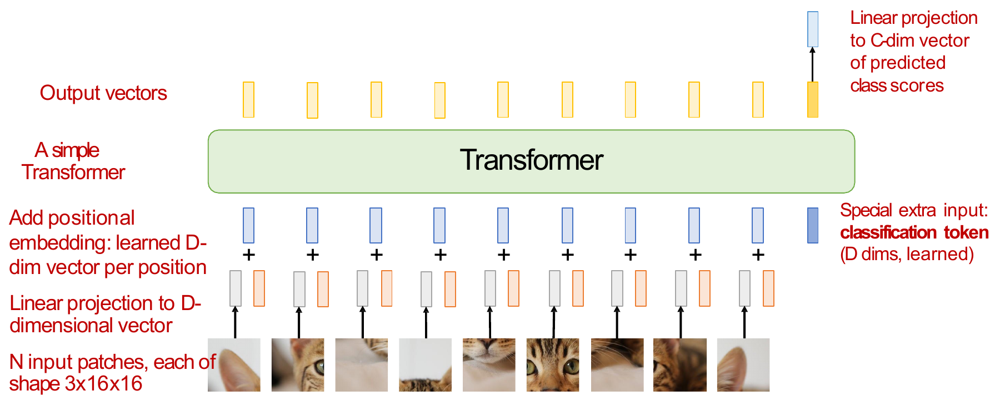
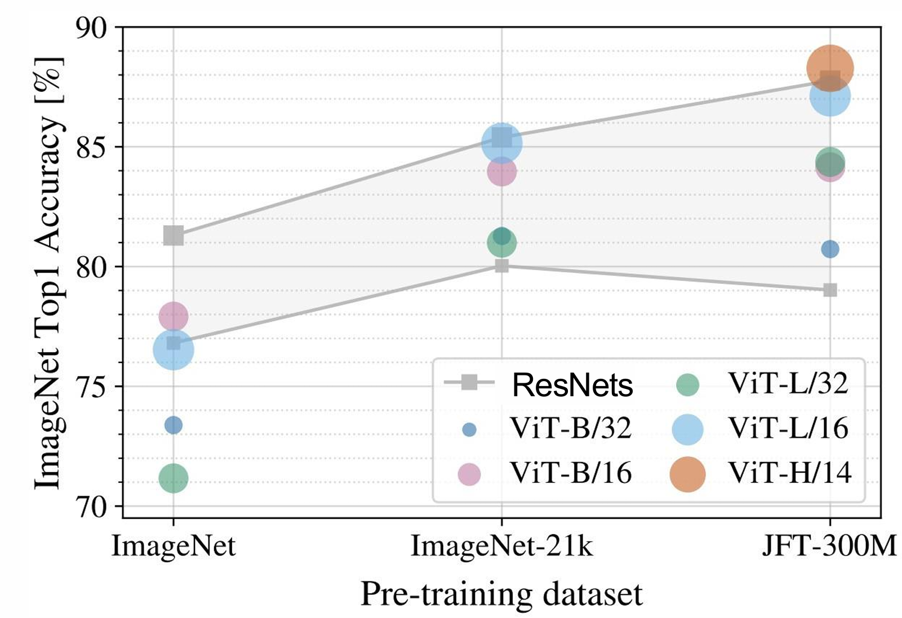
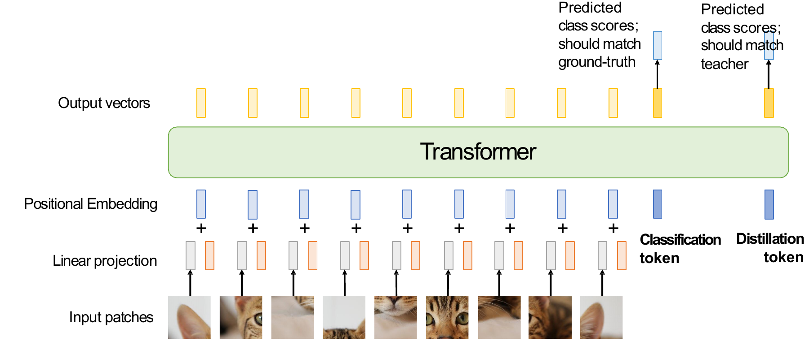
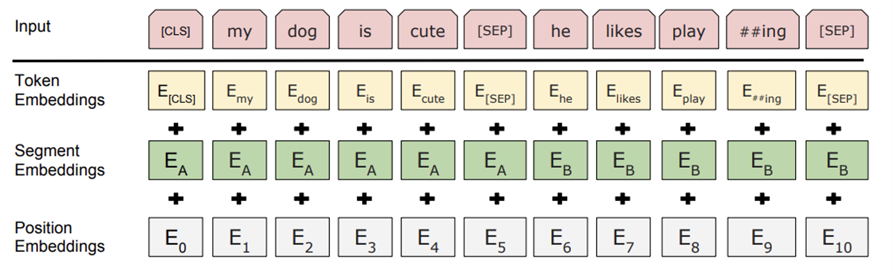
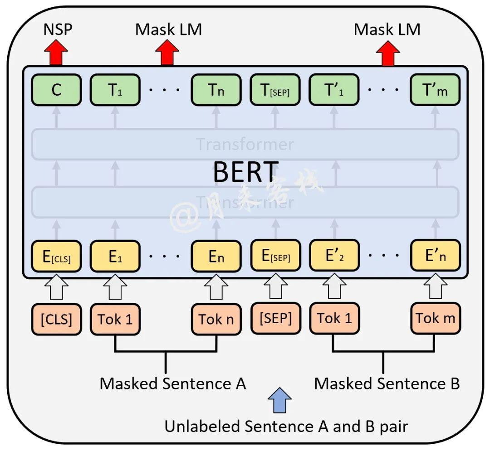
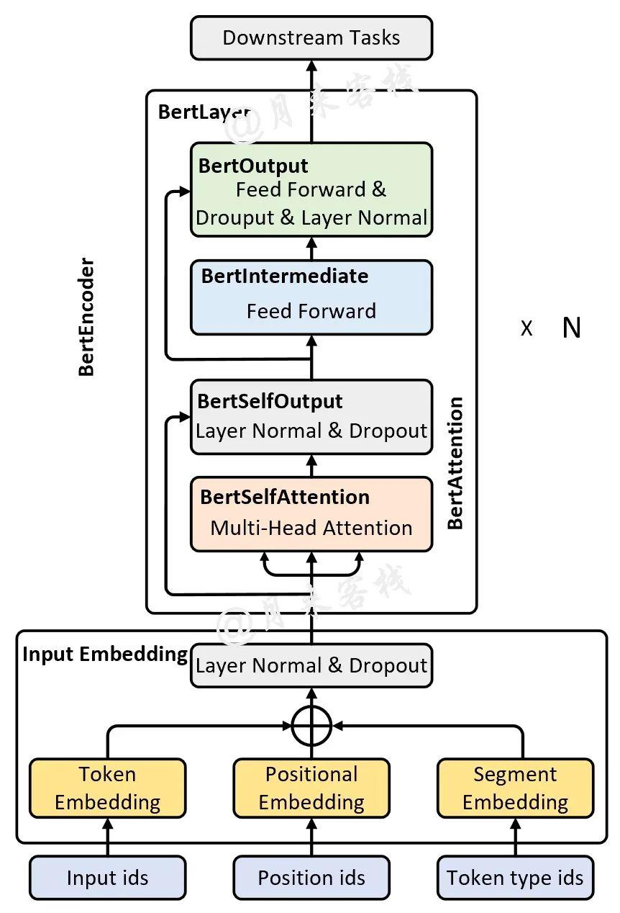
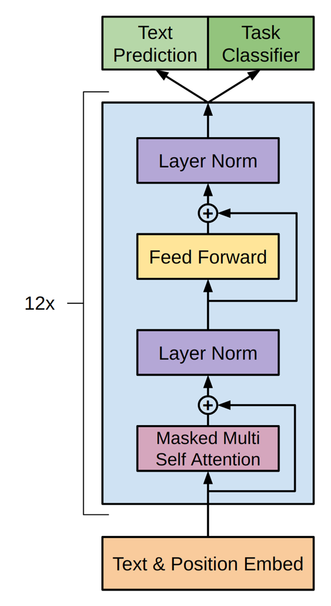
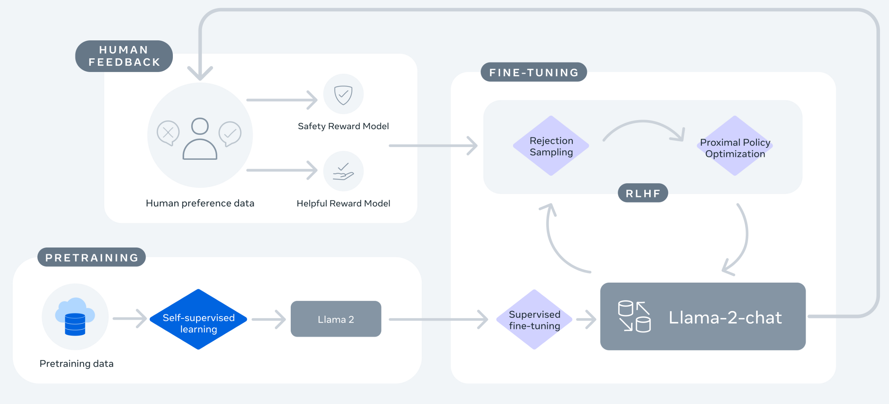
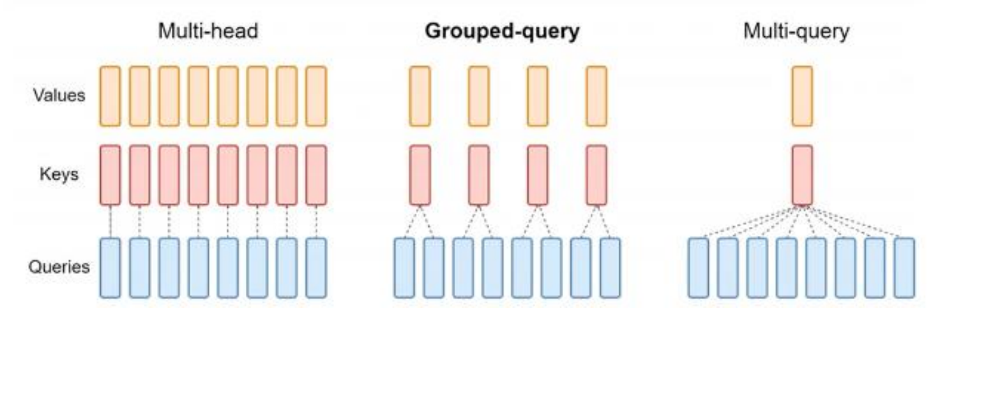
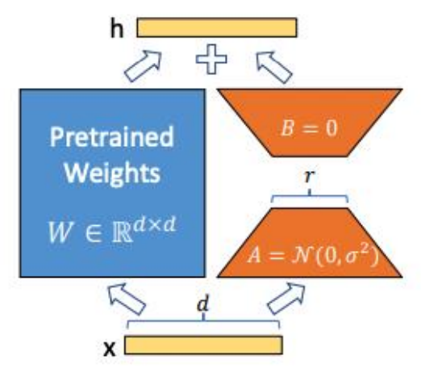

恭喜你来到了期中考试前的最后一章，我估计我是不会去做这之后的笔记了。本章会介绍一大堆 Transformer 模型，包括：

- Vision Transformers(3)
  - ViT
  - Improving ViT 1
  - Improving ViT 2
- NLP Transformers(8)
  - BERT
  - GPT 1 2 3
  - LLaMA 1 2 3
  - LoRA
- Multimodal Transformer(4)
  - LLaVA
  - BLIP 1 2
  - InstructBLIP
  - MiniGPT4

因为太长了，这一章只记到 LoRA 之前，后面多模态的部分放到下一章。

# 一、CV Transformer

Transformer 在设计之初是只考虑文字输入的，那么图像 Encoder 能不能也直接用 Transformer，连 CNN 都不要了？当然可以，最直接的想法是，把每个像素当成一个 token（ICML 2020）。

对于 $R\times R$ 的图片，序列长度就是 $N=R^2$，一个注意力矩阵的大小便是 $N^2=R^4$。假如是 $128\times128$ 的图片、48 层、每层 16 个头，每个像素对应一个 token，每个注意力元素用 32 位浮点数保存，仅一个样本的所有注意力矩阵就需要：

$$
128^4\times48\times16\times4\text{ bytes}=768\text{ GiB}
$$

注意，这还没有算参数、其他中间激活和梯度，这个内存就已经爆炸了。因此很显然的一点是，视觉输入必须先缩短序列。

## 1. ViT

**ViT**（Vision Transformer，ICLR 2021）就是利用 Transformer 处理图像分类的工作。它的方法很朴素：不要一个像素一个 token，而是一个图像块一个 token。设图片大小为 $H\times W\times C$，每个 patch 大小为 $P\times P\times C$，那么总共就有 $HW/P^2$ 个 patch，并且每个 patch 的长度是 $P^2C$。然后经过下面四步：

1. 所有 patch 共用一个线性投影 $E\in\mathbb R^{P^2C\times D}$，把每块投影成 $D$ 维向量。
2. 加入一个 $D$ 维且可学习的 **classification token**，它的目标是汇总整张图片的信息。
3. 加上位置向量，送进 Transformer。
4. 得到完整输出以后，只取最后一层 classification token 的输出，接分类头，得到类别分数。

    

仅仅是对图像进行了合适的分割，处理以后接入 Transformer，就能够完成图像分类的任务，而且不用到任何卷积层。

那么现在的内存是多少呢？对于 $224\times224$ 的 RGB 图片，如果取 $16\times16$ 的 patch，那么共有 $14\times14=196$ 块，每块展平后是 $16\times16\times3=768$ 维。投影到 $D$ 维，再加分类 token，真正输入的形状就是 $197\times D$。忽略分类 token 时，每个注意力矩阵只有 $196^2=38,416$ 个元素，以 FP32 保存约为 $150\text{ KiB}$。48 层、16 个头合计约 $112.5\text{ MiB}$，这就比按像素计算合理多了。

那这个模型的效果怎么样呢，我们拿它和 ResNet 去电子斗蛐蛐。这里需要说明，根据 ViT 的模型参数量以及 patch 的边长，会在 ViT 后面加上后缀，比如 `ViT-B/16` 中，B 表示 Base（还有 Ti，S，B，L，H 分别表示 Tiny, Small, Base, Large, Huge，参数量依次变大），16 表示 patch 边长（常用的还有 32,14）。patch 越小，序列越长，注意力计算和显存开销越大。

当两个模型都在 ImageNet 上（1k 类别，1.2M 图片）训练时，ViT 的每个模型都不如 ResNet。但是，卷积神经网络是有先验的：卷积操作本身就关注到了图片的小范围特征，因此它可以不需要太多训练数据，说不定把训练数据加多一点，ViT 的效果就会好一些。因此把两个模型都放在 ImageNet-21k 上（21k 类别，14M 图片）训练，ViT 的效果就比 ResNet 更好了。如果我们接着使用更大的数据集训练，比如 JFT-300M，那就真的吊打 ResNet 了。

    

并且，虽然 ViT 的参数量通常会比 ResNet 大，但是计算速率可不比它慢，这主要得益于 Transformer 很好的并行化设计。

## 2. 对 ViT 进行优化

### i. 数据增强和正则化

现在的优化目标很明确，既然数据不够时效果不好，我们在第二章说过，这很可能是过拟合了。同时我们还介绍过了如何解决过拟合，这里回顾一下：

| 方法 | 做什么 |
| --- | --- |
| Weight Decay | 对权重施加衰减 |
| Dropout | 训练时随机丢弃部分激活 |
| Stochastic Depth | 随机跳过一些残差分支 |
| MixUp | 混合两张图片，同时混合标签 |
| RandAugment | 随机组合图像变换 |

其中前三个是在**模型设计**上优化，后两个是**数据强化**，其中 MixUp 可以写成 $\widetilde x=\lambda x_i+(1-\lambda)x_j$，标签也对应变为 $\widetilde y=\lambda y_i+(1-\lambda)y_j$。

那我们就对 ViT 加上这些方法，然后同样在 ImageNet-1k 上训练，看看效果如何，结果见下图。中间这根竖线划分了是否加正则化，下方的横轴表示数据增强的强度，左边的轴表示不同模型。可以看到对于下面的 Base 和 Large 模型，你就猛猛加数据增强就好了；而对于 Tiny 和 Small 模型，加到 medium 强度就已经达到最高能力了，再多加就掉了。最上面两行是最明显的，加猛了直接变成红色的了。总结一下就是，适当的数据增强和正则化可以显著改善 ViT，但强度要匹配模型。

### ii. 蒸馏

所以说我们想用数据增强的方式拯救 ViT，但是这只能拯救大数据量的，怎么拯救小模型呢？**Distillation**（蒸馏）就是一个不错的选择。训练过程是：先用真实标签训练一个作为老师的大模型，再固定老师，让作为学生的小模型**同时学习教师预测和真实标签**，通过最小化两个模型预测的 KL 散度，以及真实标签的交叉熵损失来优化模型。这里的细节就在于把真实标签放进来了，这两者刚好是互补的：老师的输出不一定准确，但是它提供的是一个更软的 softmax，也就是说输出不是完全的 one-hot 向量，是模型更容易学习的向量。

如何实操呢，可以在 ViT 中额外加入一个 **distillation token**，形成两个输出分支：classification token 学真实标签，distillation token 学教师信号。两个 token 都通过自注意力与图像块交互，从而获得图像信息。

    

最后的结果是，只要加上 Distillation，ViT-B/16 就马上涨了六个点，可以说很有效了。

和前面的 DINO 联系一下：这里通常先训练好一个教师并固定它；DINO 的教师则由学生参数的滑动平均持续更新。两者都有教师和学生，但教师的来源、更新方式和监督信号不同。

# 二、NLP Transformer

## 1. BERT

BERT 提出的基础是，当时很多 CV 的任务，人们搭建一个模型后，会先进行预训练，然后对于某个具体的下游任务进行微调。但是 NLP 当时就很少有这种思想，因此 BERT 其实是 NLP 领域在这方面的开创者。

那么 BERT 做了什么呢，首先它的输入有变化。

- 添加了新的 token：CLS 表示句子开头，SEP 表示句子间的分隔符或句尾。为什么要添加这两个 token，是为了下面的预训练任务准备的。
- 为每个句子添加独立的 Segment Embeddings，以区分不同句子。
- 选用更加简单的位置编码。

    

其次就是它的训练范式发生变化，先预训练再微调。BERT 在预训练上也做了一些创新，首先它只使用 Transformer 的 Encoder 部分，不做 Decoder；其次有两个预训练任务：

- **MLM**（Masked Language Modeling）：随机对 15% 的单词进行掩码，其中 80% 是变成 `<mask token>`、10% 随机换成别的词，10% 保持不变。我看到这里就在想这个 10% 保持不变是何意味，
- **NSP**（Next Sentence Prediction）：同时输入两个句子，其中第二个句子有 50% 的概率是真的理应接在下一句的句子，50% 是随机的句子。模型做一个二分类任务，判断输入的两个句子能不能接在一起。

如下图所示，在预训练阶段，每个训练样本都是由两个句子组成的片段，对两个句子分别进行 mask 以后输入进 BERT 的核心网络。随后得到的输出维度和输入一致，CLS token 对应的输出用于进行 NSP 判定，两个句子进行 MLM 判定，综合两个任务进行预训练。

    

预训练完成后，我们就可以对该模型进行各种下游任务的微调，可以支持下面这些任务：

- 对两个句子进行分类的任务，仍然只需要在 CLS 对应的位置输出类别即可；
- 对单句子进行分类的任务，只需要把后半句子砍掉就行了；
- 对于“给定 Question，要求从文中找到作为回答证据的原文”的任务，只需要把整个文本输入进去，对每个输出做三分类任务：`start/end/span` 即可；
- 对于序列标注任务，只需对每个输出做多分类任务即可。

虽然 BERT 的模型不是很重要，但是我还是挂出来给大家看一眼吧。

    

## 2. GPT 系列

**GPT 1** 甚至比 BERT 还早，它的信息如下（其实都不重要）：

- 只包含 Transformer 的 Decoder 部分，和 BERT 恰好相反；
- 12 层；
- 隐层维度 768；
- 1.17 亿参数；
- 使用 GELU 激活函数；
- 单词预测采用自回归任务形式。
- 微调时启用 Task Classifier。

模型结构如下图。可以看到由于采用 Decoder 架构，因此多头注意力是 Masked 形式的，不能看到后面的词。训练目标是最大化 $P(u_i|u_{i-k},\cdots,u_{i-1})$，大概就是一个 k-gram 模型。

    

现在这个模型看起来能做的事情很少，基本上只能输入一个句子，输出一个句子。能不能支持情感分析、句子分类等更多任务呢？能，但比较困难，在 Finetuning 过程中甚至需要在输入中添加各种各样新的 token。我就举个例子吧，对于分类任务，需要在句子前面加一个 start token，最后加一个 extract；对于多选项选择题，需要在问题前面加一个 start，问题和答案之间加一个 delim，答案最后加一个 extract，并且每个选项需要单独封装成一个输入，分别输入进去，最后经过 softmax 得到每个答案的置信度。很明显这超级麻烦啊。

因此 **GPT 2** 的任务就是尽可能避免对下游任务的微调。怎么实现呢，GPT 1 的思路是优化 $P(\text{Output}\mid\text{Input})$，而 GPT 2 的思路是优化 $P(\text{Output}\mid\text{Input,Task})$。而 Task 其实只是一段对任务的描述而已。

当然同时，GPT 2 的训练数据、词汇量、batchsize、模型参数量也是高度提升，这里就不罗列数据了，只说一个参数量变到了 15.42 亿。

也是在 GPT 2 时，**Scaling Law** 被发现了，简单来说，只要加参数量，模型就能完成原来没法完成的任务。

到了 **GPT 3**，它的核心思想是，人类想要完成一个新任务，不需要那么多训练，只需要给他举几个例子就可以了。因此，GPT 3 的核心操作就是，减少训练样本，而在每一个训练样本中，都给模型提供一些输入输出例子（叫做 Few-Shot。只给一个例子叫 One-Shot，不给例子叫 Zero-Shot）。除此之外，模型架构和 GPT 2 是一模一样的。

除此之外，GPT 3 严格遵循 Scaling Law，已经把参数量提升到了 175B，batchsize 开到了 320 万！！同时他们在尽可能把训练数据的质量和数量都堆起来。数量堆起来很简单，但是质量很难和数量同步提升吧？这个其实很好解决，对于一些高质量数据集（论文中点名表扬 Wikipedia），他们就多采样；对于低质量数据集（比如一些网络数据），就少采样。

同时他们还发现了一些结论，比如参数量越大，Few-Shot 带来的性能提升越明显。

最后是 **GPT 4**，整篇文章唯一有用的信息是：RLHF 只能对齐人的偏好，而不能提升模型性能。多的就不说了好吧，如果你喜欢赤石，就去读原论文吧，学习如何写大篇幅废话。

## 3. LLaMA 系列

这个系列有个伟大的构想：开源至上，所有数据模型啥的都开源，同时模型的性能还得能打，走开源 GPT 的路子。而这条路子在当时是很成功的，最辉煌的战绩是在某些任务上，使用几十亿参数量的模型打败 1750 亿的 GPT 3。

LLaMA 的核心思想就和 GPT 不一样，GPT 在疯狂堆参数的同时，会导致测试的开销超级高（毕竟还是要前向传播的）；而 LLaMA 的想法是，通过提升训练数据的质量，降低参数量的需求。

因此 **LLaMA** 使用了大量来自 CommonCrawl, C4, Github, Wikipedia 等英文数据，同时进行了质量控制，得到了 1.4T 的训练 token。而结构上就没啥好说的，仍然是只使用 Transformer Decoder，不过把 LayerNorm 换成了 RMSNorm，激活函数换成了 Silu（即 Swish），同时使用 RoPE。

**LLaMA 2** 基本没啥变化，就是接着堆数据。不过在训练手法上，它还是博采众长，得到了一个现在大家广为使用的训练框架，如下图所示。从左下角开始，就是一个很简单的自监督预训练，得到 LLaMA 2 的基础模型。后续的操作都是针对 chat 版本的微调。先到右边，这里出现了 Supervised fine-tuning，这是人为提供的“示范回答”，告诉模型什么回答是好的。再到左上角的人类反馈，是由人工进行 preference data 的标定，选出哪些答案是好的，哪些是不好的，从“回复安全性”和“回答有效性”两个角度打分。最后就到了右上角的强化学习 RLHF，使用了 PPO 方法。

    

效果很显著，即使训练 token 来到了 2T，模型性能仍然能够稳定提升。这里就可以看到 LLaMA 和 GPT 的区别，LLaMA 的横轴是训练数据量，GPT 的横轴一般是参数量。

LLaMA 2 还有一个比较显著的创新点，叫 **GQA（Group Query Attention）**。我们首先回顾原始的 attention，每个 query 对应一个 key，计算相关性后归一化，作为 value 的权重。假如此时输出了一个新的 token，它其实不会影响之前位置的 KV 值，只是 Query 改变了，因此大家也常提到 KV cache，即缓存历史 KV 值，这可以将复杂度从 $O(n^2)$ 降到 $O(n)$。不过问题是一旦序列太长，就很吃显存。

    

最激进的想法就是最右边的操作，所有 Query 共用一个 KV，这显然会限制模型的表达能力。因此折中的方法是中间的 GQA，每两个 Query 共用一个 Key 和 Value，能使 KV cache 减半，计算速度提升，同时表达能力不减弱。这个最初被用在 LLaMA 2 的 70B 版本上，到 LLaMA 3 的时候就给所有版本都用上了。

**LLaMA 3** 就真的是巅峰了，稳定碾压 LLaMA 2，某些任务上碾压 GPT 3.5，甚至某些任务上能打败 GPT 4，可谓非常恐怖。

那么它做了什么呢，包括下面这些操作：

- 全方面使用 GQA；
- 优化分词，一个中文字符只需要一个 token；
- 上下文长度变大，训练数据接着堆，还引入了代码形状的数据以及非英文的数据，同时有很多人工标注数据。

## 4. LoRA 微调

这是最后一个知识点了。它想解决的问题是，如何微调模型，才能既更好地解决下游任务，又只进行轻量级优化，使那些即使没那么高算力的用户也能完成微调。

LoRA 的全名叫 Low-Rank Adaptation，听到低秩这个词你就该想到，前面的第六章（多模态表征）讲到过一个低秩操作：对于一个矩阵 $W$，可以使用奇异值分解，把它近似成 $r$ 组秩一矩阵相乘后相加。这里用到的就是这个思路，只不过把它用在微调上了。

具体怎么操作呢，对于一个预训练好的权重 $W_0\in \mathbb R^{d\times k}$，我们微调的原目标是把这个权重变成 $W_0+\Delta W$，其中 $\Delta W$ 是微调值，这里的参数量是 $dk$。我们做一定弱化，将它近似为 $W_0+BA$，其中 $B\in \mathbb R^{d\times r},A\in \mathbb R^{r\times k}$，且秩 $r<<\min(d,k)$。这里的近似其实就是把原本可能高秩的 $\Delta W$ 限制到秩不超过 $r$ 了而已。不过此时的参数量下降到了 $r(d+k)$，实现了极大的优化。

    

它的优点是：

- 在测试时没有任何额外的计算量
- 能够泛化到任何模型的任意权重矩阵

图中可以看到，LoRA 需要精心初始化 $A$ 是高斯分布，$B$ 为零矩阵，为什么呢？首先，最初的 $BA=0$，先保持了模型初始的状态。那为啥 $A$ 不置零呢，因为如果同时为零的话，你的 $BA$ 是相乘的，那不管谁产生梯度，另一个零矩阵都会把梯度砍掉，训练就没法启动了。

完结撒花！